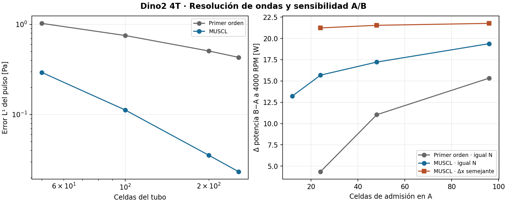

# Dino2 · Informe final de aceptación de etapa 4

**CLOSED en el dominio de uso definido abajo.** El candidato verifica el solver 1D, el acoplamiento conservativo al cilindro 4T y el recorrido de comparación geométrica en Windows. La resolución de una diferencia concreta se comprueba en su régimen y geometría. La verificación numérica y la plausibilidad del balance físico se completaron para los casos documentados. La validación experimental de motor y la identificación de pérdidas de conducto siguen pendientes.

## Causa de la variación de +4,4 a +15,3 W

Se conservó el caso de 402,12 cm³, 4000 RPM, Wiebe prescrita y admisión de 350 mm en A y 550 mm en B. Todo lo demás se mantuvo igual, incluido el cierre de válvula y su coeficiente de descarga. La potencia es la estimada al cigüeñal.

| Ensayo a 4000 RPM | ΔPb B−A [W] | Qué cambia |
|---|---:|---|
| Primer orden, 24 celdas de admisión en ambos | +4,35 | Referencia publicada |
| Primer orden, 48 / 96 celdas en ambos | +11,04 / +15,34 | Solo malla |
| MUSCL, 24 celdas en ambos | +15,69 | Interior y extremos reconstruidos |
| MUSCL interior, extremos constantes, 24 celdas | +15,31 | Se mantiene la reconstrucción interior |
| Interior constante, extremos MUSCL, 24 celdas | +4,66 | Se retira la reconstrucción interior |
| MUSCL, 12 / 48 / 96 celdas en ambos | +13,24 / +17,22 / +19,38 | Refinamiento con Δx distinto entre A y B |
| MUSCL 24/38, 48/75 y 96/151 celdas en A/B | +21,23 / +21,54 / +21,77 | Δx semejante dentro de cada pareja |

En los ensayos contrafactuales se cambió solo qué estado espacial alimentaba el flujo. La ley de la unión, las condiciones del depósito y el avance SSPRK2 seguían iguales. La diferencia entre aproximar o reconstruir los estados extremos fue de **0,38 W** a 24 celdas y **0,30 W** a 48. La reconstrucción interior explica la mayor parte del cambio de aproximadamente 11 W con el mismo número de celdas. La prueba independiente de propagación confirma que el esquema anterior amortigua más el pulso. Los datos no aíslan una contribución individual de dispersión frente a difusión en el ciclo real. Sí muestran una pérdida de resolución de ondas y un sesgo de cancelación cuando Δx de A y B difiere. A 24 celdas iguales, la admisión larga tiene Δx de 22,92 mm frente a 14,58 mm en A. Con 38 celdas en B pasa a 14,47 mm.

Reducir CFL y paso máximo a la mitad en el par de 24 celdas cambió ΔPb en **0,0058 W**. Reducir la tolerancia periódica de 1e−6 a 1e−8 cambió ΔPb en aproximadamente **1e−5 W**. Los cierres de ambas uniones y los balances por conducto están en la sección de verificación. No se encontraron evidencias de un error de contabilidad ni de convergencia temporal o periódica que explique la variación de varios vatios. Cambiar el modelo físico de válvula o la impedancia exterior podría alterar las predicciones. Esas incertidumbres permanecen.

Con paso semejante, las dos mallas más finas difieren **0,23 W** y **0,00135 puntos porcentuales de VE**; el mejor dato ensayado es **+21,77 W**, aproximadamente **+0,052 N·m** y **+0,167 puntos porcentuales de VE**. Los cuatro niveles con igual N en A y B muestran una variación no uniforme. Las tres parejas con Δx comparable respaldan el signo y una caracterización empírica, pero no se atribuye orden asintótico ni incertidumbre de motor. El [procedimiento de NASA para convergencia de malla](https://www.grc.nasa.gov/www/wind/valid/tutorial/spatconv.html) fundamenta la distinción.

La modificación del diámetro exterior del escape de 36 a 50 mm, con 32 mm en la válvula, mostró **+484,14 / +482,50 / +482,74 W** a 4000 RPM con 24/32, 48/64 y 96/128 celdas de admisión/escape. En este caso la señal supera ampliamente la dispersión de las tres mallas. Tanto la diferencia de admisión como la de escape son del modelo ensayado.



## Formulación consolidada y referencias

Se mantienen las ecuaciones de Euler cuasi-1D, el transporte de siete especies, la energía total con formación química y la ley de válvula descrita en el [informe de etapa 4](informe-etapa4.md). El nuevo identificador es `four-stroke-isooctane-ducts-v4-muscl`. Los proyectos con el identificador anterior siguen ejecutándose con estados constantes por celda y selección anterior del pico de presión. El pico del candidato se mide en los estados aceptados y se usa en la fricción, independientemente del intervalo con que se dibuja la traza.

MUSCL reconstruye presión, temperatura, velocidad, fracciones de especies y marcador mediante pendiente centrada limitada por diferencias unilaterales izquierda y derecha. En el extremo se extrapola desde una pendiente limitada de las últimas tres celdas. Una escala común limita las caras a valores admisibles y se normaliza la mezcla de cada cara. La actualización aplica un único flujo por cara compartida. Presión por gradiente de área constituye la fuerza de pared de la ecuación de momento, sin fuente en masa ni energía. HLLC, respaldo HLL, la reflexión simétrica en cierre, la tobera con impedancia en apertura y la integración SSPRK2 se conservan. El CFL considera velocidades de propagación tanto de centros como de caras. La validación de promedios rechaza etapas inadmisibles y reduce el paso sin recortar el promedio. Estas verificaciones no prueban positividad incondicional para un Euler general. [Van Leer, reconstrucción lineal conservativa](https://doi.org/10.1016/0021-9991%2879%2990145-1) · [Ketcheson, LeVeque y del Razo, Euler y Sod](https://faculty.washington.edu/rjl/riemann_book/Euler_equations.html).

## Verificación y dominio

- **Ondas.** Una perturbación gaussiana de 12 Pa viaja sobre aire a 1 bar y 300 K. A 200 celdas, el error espacial L¹ de presión viajera pasa de 0,507 Pa a 0,0354 Pa, y el error del pulso reflejado de 0,772 a 0,0637 Pa. El pico viajero pasa de 7,61 a 11,61 Pa. Con MUSCL, el L¹ de propagación a 50/100/200/256 celdas es 0,294 / 0,112 / 0,0354 / 0,0233 Pa. El extremo abierto con estado de depósito igual al ambiente deja un residuo menor a 0,1 Pa tras salir el pulso en ese ensayo lineal. El valor no caracteriza una terminación real de escape.
- **Saltos, geometría y estabilidad.** Sod tiene una solución analítica con choque, contacto y rarefacción. Se verifican tres mallas en ambos esquemas. Un tubo con relación de presiones inicial de 100 mantiene presión positiva y cierra los balances; un ducto 20→80 mm a presión uniforme se mantiene en reposo. La referencia subsónica isentrópica de área variable y el ensayo temporal a malla fija siguen pasando.
- **Conservación acoplada.** Para los ensayos A/B se comprueban el inventario y flujo de cada especie y energía de cada conducto, junto a los flujos de válvula del cilindro. La identidad local es el balance FV por cara y la continuidad de flujo 0D↔1D. El momento de cada conducto incluye los flujos extremos y la integral de la fuerza de área. Los residuales son del orden de 1e−17 kg, 1e−11 J y 1e−13 N·s o menores en los ensayos entregados. El cilindro 0D absorbe el flujo de energía y no resuelve momento axial. El balance periódico incluye el estado de cada celda. La suite incluye un caso arrastrado a 55/150 kPa de admisión/escape y rechaza una corrida limitada a tres ciclos.
- **Repetibilidad y regresión.** Pasaron 45 grupos de pruebas de código, 34 comprobaciones WPF y la campaña separada de refinamiento. Se conservaron Otto, v1, v2, v3 y v4 de primer orden. La exportación conserva identidad y caudales de válvula. Las pruebas de interfaz abren, simulan, conservan A, editan B, contrastan la malla y exportan. El entorno de publicación tiene su propio runtime .NET 10 y se probó por automatización nativa.
- **Dominio de aceptación.** Motor 4T monocilíndrico con cilindro homogéneo, iso-octano vaporizado y el alcance termoquímico de v3, dos conductos inviscidos adiabáticos unidos a depósitos estacionarios, diámetros lineales por conducto y cierre de válvula cuasiestacionario. Las verificaciones de motor cubren el barrido de 2000 a 6000 RPM del ejemplo, con estudio de ambas geometrías y de paso temporal a 4000 RPM. El rango de entrada de la aplicación es mayor que el conjunto de casos verificados. Cada preparación se interpreta dentro de sus balances, periodicidad y resolución comprobados. La demostración usa Wiebe prescrita; una extrapolación de Wiebe escalada conserva las advertencias y restricciones de v3. No se representan pérdidas viscosas, transferencia térmica ni separación en los conductos, redes de ramales o impedancia medida de una instalación. La precisión predictiva para esas condiciones queda fuera del cierre.

## Uso de A/B y criterio de resolución

Abrí `examples/4t-ducts-muscl-ab.json` en el portable, pulsá **Simular** y entrá a **A / B**. El ejemplo incluye 24 y 38 celdas de admisión para pasos comparables. **Conductos** superpone presión y caudal de A y B para el régimen elegido en **Ciclo**. En la tabla, las diferencias de las curvas son de la malla configurada. Si la longitud de celda difiere más de 15 % entre A y B, aparece una advertencia.

**Comprobar malla A/B** calcula B−A sin reemplazar las curvas base, en un régimen elegido y con base, doble y cuádruple número de celdas. Requiere mallas base de hasta 64 celdas por conducto, igual modelo, CFL y ajustes de cilindro y depósito. A y B pueden tener números de celdas distintos. La comparación conserva geometría original y variante. La banda mostrada es dos veces el mayor cambio entre refinamientos sucesivos. Se marca «señal superior a la variación» cuando el signo se mantiene, el último incremento es menor o igual al anterior y el valor fino supera esa banda. En los demás casos se muestra «diferencia indeterminada». Es un criterio empírico de resolución en ese régimen, sin orden impuesto. La exportación conserva los tres valores y la banda en `.mesh.json`. Estado no periódico, corrida cancelada o comparación sin estudio llevan a resultados sin resolución comprobada.

## Rendimiento

Se midió el mismo espécimen a 4000 RPM con malla 48/64, mismo CFL y pasos. Dos ejecuciones pareadas de Release pasaron de **10,84 / 10,68 s** a **6,47 / 6,58 s**. La mediana bajó de 10,76 a 6,52 s, alrededor de 39 %. Ambas versiones dieron 34 026 pasos aceptados y la diferencia de potencia fue de **3,2 µW**. El coste de ampliar la malla incluye el mayor número de celdas y el menor paso por CFL.

El perfil de pilas EventPipe de `dotnet-trace` antes de optimizar situó aproximadamente el 83 % inclusivo en `DuctMesh.Prepare`. `Decode` y `Encode` concentraban 43 % y 22 % exclusivos. La optimización reutiliza la T anterior de cada celda como semilla de Newton con el mismo criterio y un intento con semilla fija si falla, fusiona pasos del cálculo EOS de las caras, calcula solo las caras necesarias al muestrear la traza e intercambia buffers preasignados después de cada paso aceptado. El perfil posterior concentra el coste en reconstrucción (aprox. 42 % exclusivo) y preparación. La captura no es una medición de tiempo de Release sin perfilador. Los dos ensayos se mantuvieron con la misma malla y precisión.

## Reproducir y verificar el candidato

```powershell
.\scripts\verify.ps1
dotnet run --project tests/Dino2.FourStroke.Tests -c Release -- --muscl-only
dotnet run --project tests/Dino2.Reactive.Tests -c Release -- --closure
dotnet run --project src/Dino2.Cli -c Release -- --4t examples/4t-ducts-muscl-ab.json curva.csv traza.csv
.\scripts\publish.ps1 -Destination artifacts/stage4-rc-win-x64 -Archive artifacts/Dino2-stage4-rc-win-x64.zip
.\scripts\smoke-publish.ps1 -Application artifacts/stage4-rc-win-x64/Dino2.Desktop.exe
```

Los resultados están en `artifacts/stage4-closure`. Para reconstruir los contrafactuales y comparar rendimiento con la versión MUSCL anterior a la optimización, preparar `git worktree add --detach .tools/stage4-boundary-study fac1ffc` y construir allí CLI Release con salida `.tools/stage4-preopt` relativa a la raíz principal. Desde la raíz principal ejecutar `python scripts/check-stage4-optimization.py` y `python scripts/check-stage4-boundary.py`. El gráfico usa `python scripts/plot-stage4-closure.py` con matplotlib. Se puede sustituir dotnet por el SDK local `.tools/dotnet/dotnet.exe`.
