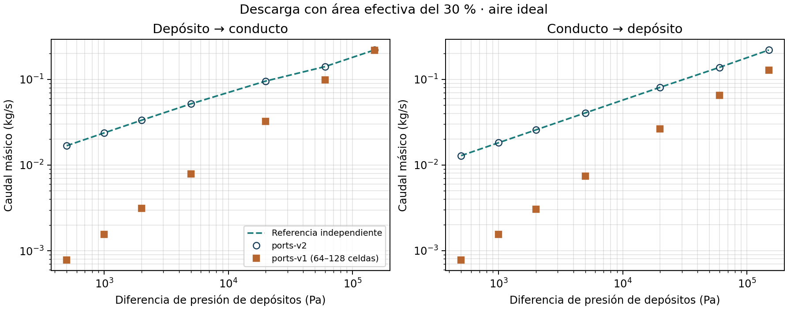
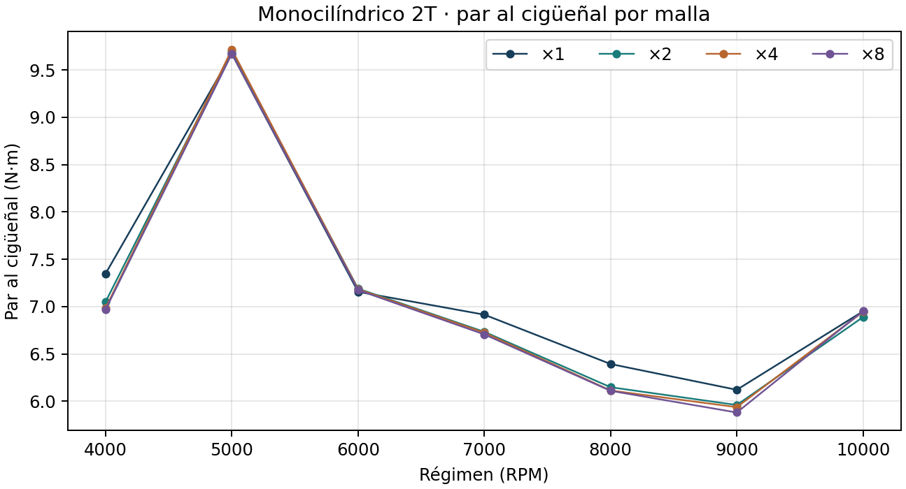

# Etapa 13 · Descarga por aberturas parciales

**Veredicto: CONDITIONAL / RESTRICTED.** La pérdida espuria a bajo salto de presión de `ports-v1` queda corregida y verificada con referencias independientes en el banco ideal. La descarga fuertemente subexpandida conserva una aproximación compacta. El par absoluto y algunas diferencias 2T siguen sujetos a resolución espacial y a incertidumbre física. No hay validación experimental nueva.

## 1. Diagnóstico

La etapa 12 resolvía una característica del conducto con la presión y velocidad de la garganta. Luego distribuía sobre la sección total la masa que atravesaba el área reducida. Para densidades aproximadamente iguales, el conducto recibe una velocidad media (u_m\simeq\alpha u_t), con (\alpha=A_t/A), mientras que la onda se resolvía con (u_t). La diferencia produce un término de orden (\rho c(1-\alpha)u_t) por impedancia acústica, incluso al llegar al estado estacionario. Una expansión inercial tiene una pérdida de orden (u_t^2).

Se repitió el banco anterior desde su binario, en un directorio de etapa 13. Con \(\alpha=0,3\), \(p_0/p_2=1,05\) y depósito→conducto, dio 0,00787524 kg/s frente a 0,04055580 kg/s para la tobera ideal sin recuperación. A 500, 1000 y 2000 Pa dio 0,00077688, 0,00155628 y 0,00312239 kg/s. Al duplicar la diferencia de presión casi se duplicaba el caudal. Los casos y archivos de referencia permanecen en `90c7aad`, la rama de recuperación y la evidencia anterior.

## 2. Selección y formulación

Se evaluaron la tobera isentrópica sola, una pérdida lumped con coeficiente empírico y una contracción isentrópica acoplada a una expansión brusca. La primera sirve de referencia para descarga hacia un volumen de reposo. Para el sentido volumen→conducto, la expansión brusca permite recuperar presión estática y obtener una pérdida de presión total a partir de masa, energía y momento. El hombro anular se supone a presión de garganta antes de la mezcla. Este supuesto es una aproximación de flujo separado, comparable a un balance tipo Borda–Carnot. Los coeficientes de descarga existentes representan área efectiva y proceden de los parámetros del motor. Su dependencia de apertura, dirección, geometría y salto de presión es una fuente distinta de incertidumbre. [NACA 1135, relaciones compresibles](https://www.grc.nasa.gov/WWW/K-12/airplane/Images/naca1135.pdf) · [NACA L4L19, expansiones bruscas subsónicas](https://ntrs.nasa.gov/api/citations/19930093614/downloads/19930093614.pdf) · [Blair y Magee, acoplamiento no isentrópico de secciones](https://doi.org/10.4271/932399) · [Blair, Callender y Mackey, mediciones de Cd](https://doi.org/10.4271/2001-01-1798).

El área geométrica disponible la dan la alzada y el área de paso, o la lumbrera y su apertura. La lámina emplea su ley de apertura. Cada modelo aplica su propio \(C_d\) antes de invocar el cierre, que recibe \(A_t\) efectivo limitado por la sección \(A\) del conducto. Presión en Pa, temperatura en K, área en m², velocidad en m/s, caudal en kg/s y entalpía en J/kg. En las ecuaciones siguientes se escribe la magnitud positiva en el sentido del flujo.

**Volumen→conducto, subsónico.** Con donante en reposo y \(c_p=\gamma R/(\gamma-1)\), se usa

\[
T_t=T_0-u_t^2/(2c_p),\qquad p_t=p_0(T_t/T_0)^{\gamma/(\gamma-1)},\qquad
j=\dot m/A=\alpha\,\frac{p_t u_t}{R T_t}.
\]

El balance a través del escalón da \(p_m+j u_m=p_t+j u_t\). La contribución de presión del hombro sobre el gas es \((A-A_t)p_t\) en el sentido del flujo. Con \(T_m=T_0-u_m^2/(2c_p)\) y \(j=p_m u_m/(RT_m)\) se obtiene una cuadrática. Se toma la raíz subsónica inferior y se empareja \((p_m,u_m)\) con la curva de onda del estado interior del conducto. En el límite de densidad prácticamente constante,

\[
p_0-p_m\simeq\tfrac{\rho}{2}\big[u_m^2+(u_t-u_m)^2\big],\qquad u_m\simeq\alpha u_t .
\]

Así, el caudal estacionario tiende a \(\sqrt{\Delta p}\) y la pérdida de remanso tiende a \(\rho(u_t-u_m)^2/2\). En la rama bloqueada se fija \(u_t=\sqrt{2\gamma R T_0/(\gamma+1)}\). La onda y la entalpía determinan el estado medio a masa fija hasta que la sección media alcanza Mach 1. En ese límite se emplea la traza sónica como contorno del conducto. En la expansión subexpandida, la diferencia de momento entre la traza y el chorro corresponde a la reacción compacta de pared y región de mezcla sin resolver. No se extrapola la hipótesis de presión uniforme en el hombro a una predicción de la estructura del chorro.

**Conducto→volumen.** El estado medio está sobre la curva de rarefacción o de choque del conducto. Su remanso define la tobera de contracción. La garganta toma la contrapresión si es subcrítica, o \(p_t=p_{0,m}[2/(\gamma+1)]^{\gamma/(\gamma-1)}\) si hay bloqueo. Se igualan las masas en los dos planos. Con flujo supersónico incidente se evalúa primero si el salto de un choque normal estacionario permite descargar el flujo. Si la apertura exige menor masa, el choque entra al tubo y el emparejamiento usa Rankine–Hugoniot. Mientras el flujo incidente se evacua supersónicamente, se utiliza la traza interior y se calcula el Mach de garganta por continuidad e isentropía en su rama supersónica. La expansión o el choque posterior dentro del volumen no se resuelven. La traza a abertura completa conserva el contorno de presión de etapa 12. En el cierre se impone flujo nulo y sólo reacción de presión. [NASA, relaciones de choque normal](https://www.grc.nasa.gov/WWW/K-12/airplane/normal.html).

**Intercambio conservativo.** Un solo vector entrega masa de cada especie, marcador fresco y energía con signos opuestos al conducto y al volumen. Se transporta la composición del lado donante y \(\dot m h_0\), incluida la referencia química. El flujo de momento de cara es \(A p_m+\dot m\lvert u_m\rvert\) con magnitudes positivas, coherente con el flujo axial de Euler. La diferencia de flujos de momento entre secciones incorpora la reacción sobre superficies sólidas. El volumen homogéneo integra masa y energía, sin grado de libertad de momento axial. La frontera usa γ local congelado en la onda y la tobera. En sentido conducto→volumen, la entalpía total usa el incremento sensible de \(c_p\) congelado respecto de la entalpía NASA del donante y la corrección cinética. Esta aproximación conserva la referencia química y no integra \(c_p(T)\) en el salto. Las celdas y cámaras retienen propiedades dependientes de temperatura y los controles de admisibilidad termodinámica existentes.

La implementación comparte `PortBoundary` entre las válvulas 4T y la interfaz de escape y lámina 2T. El paso de transferencia entre los dos volúmenes 2T conserva su cierre 0D–0D. El solver volumétrico, las uniones dinámicas, MUSCL, el esquema anterior, los contornos exteriores y los parámetros de combustión y fricción conservan sus ecuaciones.

## 3. Banco de descarga y conservación

Conducto recto de 0,40 m y 40 mm. Se resolvieron 0,10 s con SSPRK2 y CFL 0,35, presión baja 100 kPa, 300 K de remanso y gas perfecto de \(\gamma=1,4\). Se cruzaron cuatro áreas (0,1, 0,3, 0,6, 1), siete relaciones de presión (1,005, 1,01, 1,02, 1,05, 1,20, 1,60 y 2,50), dos sentidos y dos mallas (64 y 128). Las referencias se calculan fijando la presión lejana sin una característica transitoria. En sentido directo se resuelve el balance de presión en el escalón, y en sentido inverso se usa la tobera desde el remanso lejano. El comparador verifica error de referencia y estacionariedad al 0,5 % en este banco.

| Magnitud | Volumen→conducto | Conducto→volumen |
|---|---:|---:|
| Casos | 56 | 56 |
| Máxima diferencia relativa con referencia | 0,128 % | 0,128 % |
| Máximo desbalance caudal en caras al final | 0,0114 % | 0,244 % |
| Exponente efectivo a 500–1000 Pa, α=0,3 | 0,4957 | 0,4997 |
| Caudal con α=0,3 y razón 1,05, malla 128 | 0,05179490 kg/s | 0,04055580 kg/s |
| Caudal con α=0,3 y razón 2,50, malla 128 | 0,21993271 kg/s | 0,21993271 kg/s |



El máximo cambio de caudal al duplicar las celdas fue 0,000920 %. En el punto directo de razón 1,05, la tobera simple da 0,04055580 kg/s y la referencia con recuperación 0,05179490 kg/s. La garganta queda a 96,53 kPa y la sección mezclada a 100,00 kPa. La mayor masa respecto de la tobera simple resulta de la recuperación de presión entre planos. Respecto del remanso de entrada, la mezcla pierde presión total. Se incluyeron cierre, apertura progresiva, cambio de sentido, límite de área completa, choque Mach 2 y continuidad mediante la relación área–Mach en la rama supersónica de apertura parcial. Los pulsos de ±25 Pa regresaron con \(R=+0,985\) al cerrar, \(R=-0,981\) a \(-0,983\) con α=0,3 y \(R\simeq-0,985\) a sección plena.

| Máximo absoluto en el balance integrado | Gas perfecto, 112 casos | Aire y productos, 24 casos |
|---|---:|---:|
| Masa total | 8,38×10⁻¹⁷ kg | 1,53×10⁻¹⁸ kg |
| Masa de una especie | 8,38×10⁻¹⁷ kg | 1,62×10⁻¹⁸ kg |
| Energía total | 2,26×10⁻¹¹ J | 4,06×10⁻¹² J |
| Momento axial en tubo recto | 2,05×10⁻¹⁴ N·s | 2,93×10⁻¹⁵ N·s |

El control térmico cruza dos mezclas donantes, ambos sentidos, tres razones de presión y remansos de 300 y 900 K. El donante controla la composición de cara aunque el volumen receptor tenga otra mezcla. Los ensayos de motor alcanzan temperaturas superiores en las cámaras. La exactitud independiente del cierre variable a saltos de temperatura fuertes queda pendiente. El proveedor de cara y el integrador mantienen el rechazo de estados fuera de dominio.

## 4. Motor 4T auditado a 4500 RPM

Mismo caso de escape 0,85 m, Wiebe prescrito de 40°, geometría, conductos, \(C_d\), combustión y coeficientes de fricción. La habilitación por válvula se hizo en una copia de diagnóstico. El estado de garganta se guardó junto a la traza de ciclo. En las cuatro corridas CA50 fue 366,678° y la fricción calculada cambió con el estado del motor.

| Cierre | Par (N·m) | Fresca al cierre (mg) | VE | Trabajo bruto (J) | Bombeo (J) | Fricción (J) | Residual en SOC |
|---|---:|---:|---:|---:|---:|---:|---:|
| Etapa 11, histórico | 28,91 | 421,20 | 0,906 | — | — | — | — |
| `ports-v1`, ambas | 16,573 | 282,67 | 0,6078 | 324,60 | −39,73 | 76,60 | 8,27 % |
| `ports-v2`, sólo admisión | 28,582 | 421,80 | 0,9070 | 487,01 | −46,26 | 81,57 | 5,78 % |
| `ports-v2`, sólo escape | 18,937 | 300,03 | 0,6452 | 344,63 | −29,61 | 77,05 | 5,59 % |
| `ports-v2`, ambas | 29,983 | 433,68 | 0,9326 | 500,96 | −42,28 | 81,89 | 4,77 % |

El incremento de par de 13,410 N·m se descompone en 11,528 N·m de admisión y 1,883 N·m de escape al asignar a cada uno el promedio de su efecto marginal en ambos órdenes. La interacción es −0,962 N·m con respecto a sumar ambos efectos aislados. La presión de puerto de admisión pico a pico cae de 151,13 a 45,39 kPa y el flujo positivo integrado alcanza 437,27 mg, con retorno de 3,59 mg. En el caso con ambas válvulas nuevas, la traza muestreada alcanza Mach 0,827 en garganta de admisión y Mach 1 en escape. Las diferencias máximas garganta–sección son 27,21 y 192,76 kPa, respectivamente. La masa fresca adicional explica el aumento de trabajo bruto, mientras el bombeo se vuelve algo más negativo. La etapa 13 completa además 3000, 4500 y 6000 RPM con escapes de 0,25/0,40/0,65/0,85 m y mallas ×1/×2. Los cambios de par entre estas mallas son como máximo 0,012 N·m en esos casos.

## 5. Comparación A/B en colector 4T

Dos cilindros, 4000 RPM, A = 2,4 L y B = 3,6 L. La discretización cambia junto al máximo paso angular. La banda observada es el mayor cambio entre niveles consecutivos en la diferencia B−A. Sirve para este contraste de malla, con el contorno y la fase fijados.

| Tronco | `ports-v1` ×1 (W) | `ports-v2` ×1 (W) | ×2 (W) | ×4 (W) | Banda observada (W) |
|---|---:|---:|---:|---:|---:|
| 0,38 m | −473,78 | −603,58 | −619,82 | −622,27 | 16,24 |
| 0,55 m | +1598,70 | −465,93 | −468,76 | −468,58 | 2,84 |

B es inferior en los dos contrastes de la revisión actual, con signo estable en las tres resoluciones. En ×4, con 0,38 m, la presión pico a pico del pleno aumenta de 15,62 a 21,11 kPa al pasar de A a B. La masa fresca por cilindro baja de 434,26 a 427,31 mg y su trabajo neto de 492,22 a 482,66 J. Con 0,55 m, la presión del pleno cae de 44,49 a 29,16 kPa, la masa fresca baja de 380,83 a 368,41 mg y el trabajo de 428,46 a 420,96 J. La evidencia incluye caudal y presión de ambos puertos. El armónico dominante en estos ciclos es 66,7 Hz. El desfase pleno–tronco en ese armónico pasa de −1,12° a −2,07° en el tronco corto y de −1,85° a −1,19° en el largo. Los modos lineales de referencia son 90,96/80,05 Hz para 0,38 m y 73,96/65,34 Hz para 0,55 m. El cálculo modal supone aire uniforme y ramales con extremo cerrado. La frecuencia excitada y la masa entrante dependen de la interacción con las válvulas y su fase.

## 6. Refinamiento 2T

Todas las configuraciones de esta tabla completaron ciclos periódicos. El paso temporal máximo y la tolerancia de periodicidad se redujeron con la malla. Las trazas y el resumen conservan potencia, masa fresca, barrido, atrapamiento, trabajo del cárter, presión de puerto, ondas de escape, flujo de lámina y transfer, balances y pasos.

| RPM | Par ×1 (N·m) | ×2 | ×4 | ×8 |
|---:|---:|---:|---:|---:|
| 4000 | 7,34813 | 7,05115 | 6,98396 | 6,96964 |
| 5000 | 9,67112 | 9,69264 | 9,71568 | 9,67073 |
| 6000 | 7,15644 | 7,18994 | 7,18402 | 7,17482 |
| 7000 | 6,91516 | 6,73391 | 6,72479 | 6,70687 |
| 8000 | 6,39399 | 6,14893 | 6,11433 | 6,11098 |
| 9000 | 6,12163 | 5,96093 | 5,93812 | 5,88182 |
| 10000 | 6,95076 | 6,88941 | 6,94512 | 6,95250 |



A 4000 RPM, refinar sólo el escape de 32 a 64 celdas cambia el par −0,29643 N·m y la masa fresca −1,811 mg. Refinar sólo la admisión de 12 a 24 cambia −0,00203 N·m y −0,0125 mg. A 9000 RPM, los cambios de par son −0,16267 y −0,00262 N·m, respectivamente. El escape domina la sensibilidad en ambos controles. A 5000 y 10000 RPM hay cambios no monótonos. A 9000 RPM queda un cambio de 0,05630 N·m de ×4 a ×8. La periodicidad permite usar la solución de ciclo de cada malla. La resolución de diferencias pequeñas exige un contraste propio, especialmente alrededor de resonancias. El refinamiento combinado con el paso no asigna toda la diferencia al error espacial.

En el control temporal con malla fija ×2, CFL 0,20, paso máximo de 0,1° y tolerancia periódica de 10⁻⁶, el par varió −0,00220 N·m a 8000 RPM y −0,00128 N·m a 9500 RPM respecto de la corrida de referencia. A 9000 RPM el pico espectral del escape permaneció en 450 Hz en los refinamientos parcial y global, con amplitudes de presión pico a pico distintas.

## 7. Redes, rendimiento y reproducibilidad

Las redes físicas 2T y 4T completaron dos, tres y cuatro cilindros aislados y compartidos. El 4T aislado produjo 63,9735/95,9603/127,9469 N·m. El 2T aislado produjo 15,2805/22,9214/30,5620 N·m. El colector compartido 4T registró oscilaciones de pleno de 7,68 a 16,56 kPa según cilindrada de red y fase. En un cambio conjunto de fase y longitud, los trabajos 4T por cilindro pasaron de 491,89/491,89 a 503,64/472,51 J. En 2T, de 73,05/73,05 a 73,51/71,06 J. La reflexión y transmisión NF‑01 siguieron el control de complacencia lineal. En los seis casos compartidos y seis aislados de la campaña, los residuales se mantienen alrededor de 10⁻¹² J y, en 4T, 10⁻¹⁷ kg de especie en interfaz o menos al redondear por orden.

Microbenchmark con i5‑10400, 12 hilos lógicos. Mediana de cinco lotes de 50 000 evaluaciones después del calentamiento. Para α=0,3 y 500 Pa, 1,98 μs directo y 4,89 μs inverso. Con una razón de 2,50, 0,73 y 5,34 μs. Caso de área completa de razón 2,50, 1,06 μs. Cerrado, 0,032 μs. Los emparejamientos con raíz usan 24 iteraciones. La rama directa que ya alcanza la condición sónica de sección evita esa búsqueda. El costo incluye las potencias de las relaciones termodinámicas, especialmente en curva de onda y tobera en sentido inverso.

El bicilíndrico 4T A a 0,38 m pasó aproximadamente de 5,1 s en ×1 a 79 s en ×4 durante las campañas concurrentes. El 2T a 4000 RPM registró del orden de segundos en ×1 y 282 s en ×8 en la primera campaña. Las mallas más finas elevan tanto las celdas por paso como el número de pasos acústicos. Los tiempos de campañas son de pared con concurrencia y no son un benchmark aislado de escalabilidad. En la campaña de redes, pasar de dos a cuatro cilindros aislados fue de 2,0 a 3,2 s para 4T y de 9,3 a 15,9 s para 2T. No se bajó resolución para acelerar estos ensayos.

Con .NET 10 y Python 3, ejecutar desde la raíz:

```powershell
$output = Join-Path $env:TEMP 'Dino2-etapa13'
dotnet run --project tests/Dino2.FourStroke.Tests -c Release -- --stage13 bench $output
dotnet run --project tests/Dino2.FourStroke.Tests -c Release -- --stage13 thermal $output
dotnet run --project tests/Dino2.FourStroke.Tests -c Release -- --stage13 micro $output
python scripts/check-stage13-aperture.py "$output/aperture.csv" "$output/compared.csv"
dotnet run --project tests/Dino2.FourStroke.Tests -c Release -- --stage12 checks
dotnet run --project tests/Dino2.FourStroke.Tests -c Release -- --stage12 networks
pwsh -File evidence/stage13/reproduce.ps1 -Destination $output -Build -Mode mono
# Ejecutar reproduce.ps1 también con network, network-fine, two y two-fine.
python evidence/stage13/summarize.py $output
```

El arnés de investigación copia el núcleo fuera del árbol compilado de producción. Recupera `ports-v1` por commit para los experimentos controlados y genera los JSON de trazas. El programa de Windows no incorpora ese interruptor. La evidencia incluye archivos originales de campañas y derivados CSV.

## 8. Desktop, verificación y problemas abiertos

La revisión física se identifica como `ports-v2` en resultados y exportaciones. Los proyectos y estudios anteriores se recuperan con sus sellos originales. Desktop permite consultar las curvas históricas y requiere un nuevo cálculo de A y B para el contraste actual. Una prueba de carga abre archivos reales del paquete de etapa 12 y verifica que se conserva la información histórica y que el nuevo cálculo multicilíndrico renueva ambas curvas. Los estudios muestran la revisión de la evidencia y requieren un nuevo barrido antes de mezclar mallas con el solver actual.

El portable se publicó desde `85fb787` para Windows x64 con runtime .NET 10.0.15 incluido. Desde el ZIP extraído se verificaron la referencia Otto, el cálculo 4T, los estudios 4T y 2T, el refinamiento A/B del 2T monocilíndrico, guardado, reapertura, exportación, rechazo de archivos alterados y cancelación. Las pruebas Desktop cubren también los recorridos de ambas familias multicilíndricas. El ZIP de evidencia contiene las salidas de la solución completa, las pruebas del paquete Windows y las curvas por régimen y ciclo que se exportaron durante los ensayos.

El alcance verificado comprende flujo estacionario ideal, pulsos de baja amplitud, balances de mezclas, bloqueo y choques de referencia, los puntos de motor y tamaños de red indicados, y sensibilidad a malla en esas configuraciones. El siguiente contraste físico requiere mediciones de descarga por dirección y alzada, con presión de puerto y cámara. A efectos de predicción real permanecen abiertos el comportamiento del chorro subexpandido, la transferencia térmica y pérdida de presión total en escapes con onda fuerte, el efecto de \(C_d\) direccional, las propiedades variables dentro de los propios saltos y el tratamiento 0D del barrido. La reducción de sensibilidad al refinar no sustituye datos experimentales. Las diferencias A/B se restringen a las configuraciones estudiadas.
