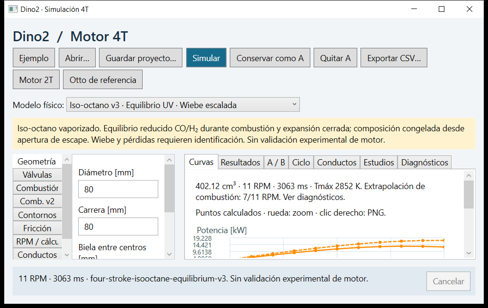

# Etapa 8 · Consolidación de Desktop

**CLOSED en los recorridos verificados.**

La etapa 7 se integró en **main** en **9e0a6b1**. El merge conserva los tres commits desde la base de etapa 6. El árbol integrado coincide con **a643d7c**. Después del merge se ejecutaron regresiones Otto, 4T, 2T, conductos 1D y estudios y se verificó el portable de la base. El trabajo de producto reside en **stage8/consolidacion-desktop**.

## Ventanas y recorridos

| Superficie | Recorrido auditado | Evidencia |
|---|---|---|
| Inicio 4T y navegación | Carga del ejemplo, selección de 2T y Otto, vuelta a 4T, reactivación con resultados 2T, ventana dueña y protección de trabajo | Automatización del portable y capturas |
| Motor 4T | Geometría, campos según modelo, simulación 0D y MUSCL, cancelación, tablas, elección de RPM de traza, guardado, exportación y recuperación, A/B | Regresiones WPF, scripts del portable y pruebas de archivos |
| Motor 2T | Editor por grupos, cálculo, dominio parcial, tablas, composición residual, presión, temperatura, flujos, guardado y reapertura, A/B y refinamiento | Automatización y regresiones 2T |
| Otto | Apertura, cálculo, edición con coma decimal, tabla, estados, caso de un punto y calor cero, archivo y CSV | Regresiones WPF y portable |
| Estudios 4T | Base, grilla de varios ejes, candidatos, objetivo, trabajo en segundo plano, contraste, aplicación B, archivo, exportación y cancelación | Pruebas de objetivos y regresiones WPF y nativas |
| Estudios 2T | Plan, base, ejes, trabajadores, objetivo, candidatos, aplicar B, contraste, guardado y CSV | Pruebas de producto y [campaña 2T anterior](etapa7.md) |
| Gráficos | Escalas, unidades, leyendas, puntos discontinuos, zoom, restauración, PNG, tamaño compacto y 125 % | Prueba del control, capturas reales y prueba de exportación |

## Registro de hallazgos

| ID | Área y severidad | Evidencia y causa | Corrección y prueba | Estado |
|---|---|---|---|---|
| DES-01 | Navegación, alta | **Volver a 4T** cerraba el editor 2T. El cierre del dueño podía omitir el ciclo normal de cierre del hijo en WPF. | Volver oculta y reactivar conserva el mismo espacio de trabajo. El dueño consulta a sus hijos y respeta cancelación y confirmación. Recorrido nativo vuelve al trabajo calculado. | Cerrado |
| DES-02 | Archivos y estudios, alta | Los nuevos resultados podían reemplazar estudios ejecutados sin guardar. | Ambas familias verifican si el estudio necesita guardado al reemplazarlo o salir. Prueba WPF de confirmación y prueba nativa del cuadro de diálogo. | Cerrado |
| DES-03 | Trazabilidad, alta | Repoblar el selector 4T al conservar A o verificar malla reasignaba la RPM anterior por la predeterminada. La traza exportada podía corresponder a otra RPM. | Se conserva la selección válida y se sincroniza el ciclo. La prueba selecciona 4000 RPM, conserva A y lee la identidad de la traza CSV. | Cerrado |
| DES-04 | Archivos, alta | Un 2T incompatible podía lanzar **InvalidDataException** fuera del conjunto capturado. Las colecciones con entradas nulas podían producir un acceso inválido. | Se valida pertenencia, estado y estructura antes de restaurar. Las pruebas con documento incompatible, entrada nula y archivo ausente preservan la curva previa. | Cerrado |
| DES-05 | Formulario 4T, media | La lectura incluía campos deshabilitados que no correspondían al modelo activo. | El análisis de valores respeta la opción física y se verifica con un valor no numérico en un conducto inactivo. | Cerrado |
| DES-06 | Gráficos, media | Las series disponían de una escala y lectura básica. El borde de tamaño fijo y las etiquetas de color por fuera del gráfico dificultaban inspección y captura. | Control compartido, leyenda con muestras, zoom con escala identificada, desplazamiento, lectura de puntos, PNG y teclado. Se preservan discontinuidades y escala inicial con cero. | Cerrado |
| DES-07 | Resultados científicos, media | Tabla 2T con magnitudes almacenadas como texto ordenaba por caracteres. Las ondas 2T compartían escala con los picos del cilindro. | Columnas numéricas ordenables con unidades y escala separada de presión en puertos. 4T añade temperatura del ciclo y composición final en opciones reactivas. | Cerrado |
| DES-08 | Ventanas y DPI, media | A 125 %, solicitar 1030 × 650 píxeles al 4T producía un mínimo de 1350 × 938 píxeles. La traza 2T podía quedar cortada al borde inferior. | Ventana inicial ajustada al área de trabajo, barras compactas y desplazamiento vertical accesible. La captura posterior conserva 1030 × 650 píxeles solicitados a 120 DPI. | Cerrado dentro del entorno probado |
| DES-09 | Apertura de archivos, media | La lectura del proyecto 2T completo se hacía en el dispatcher y creaba una cadena con todo el JSON. | Lectura desde flujo en segundo plano y aplicación al editor en WPF después de validar. Se comprueba que un proyecto de 80 RPM permite despachar otro trabajo de interfaz durante la lectura. | Cerrado |
| DES-10 | Documentación, media | Las instrucciones de distintas etapas mezclaban referencias históricas, artefactos y flujos de usuario. | Manual, referencia científica, guía de desarrollo e índice vigente. Los informes históricos preservan sus resultados. Se comprueba la apertura de los ejemplos actuales. | Cerrado |

## Referencias de interfaz

Los estudios y resultados se organizan por plan y variante, una práctica que GT-POST usa para conservar el contexto al comparar escenarios. En Dino2 se mantuvo la separación entre la definición y las curvas del estudio. [Gamma Technologies, GT-POST](https://www.gtisoft.com/training_videos/next-generation-of-data-analysis-and-optimization-in-gt-suite/).

OMEdit documenta ampliación, desplazamiento, ajuste, leyenda y guardado de gráficos. Dino2 incorpora esas interacciones a su control existente y mantiene las muestras visibles y la escala ampliada identificada. [Manual de OMEdit](https://openmodelica.org/doc/OpenModelicaUsersGuide/1.26.3/omedit.html).

El manifiesto Windows declara conciencia de DPI por monitor. Se verificaron el tamaño normal, el compacto y la navegación en la sesión disponible de 120 DPI. [Guía de DPI para aplicaciones Windows](https://learn.microsoft.com/en-us/windows/win32/hidpi/high-dpi-desktop-application-development-on-windows).

## Mediciones

| Medición del portable | Antes | Candidato |
|---|---:|---:|
| Arranque hasta el botón de simulación disponible | 1635 ms | 1496–2154 ms |
| Conjunto de trabajo inicial | 87,9 MB | 87,7–88,5 MB |
| Curva 2T de tres RPM, con actualización de interfaz | 12,41 s | 12,11–12,36 s |
| Conjunto de trabajo después de la curva 2T | 128,7 MB | 127,7–134,5 MB |
| Ventana 4T al solicitar 1030 × 650 píxeles | 1350 × 938 | 1030 × 650 |

Son observaciones de la base, el candidato y el portable final. Durante la última ejecución también corrían regresiones. El objetivo fue comprobar impacto y respuesta. Los tiempos tienen variación de entorno y no constituyen una comparación de rendimiento controlada. La medición separada de archivo grande usó un fixture de presentación de 19,05 MB con 80 filas y trazas repetidas. La lectura, validación y restauración tardaron 135–136 ms en dos pruebas y el dispatcher siguió atendiendo trabajo. El conjunto de trabajo de 303 MB incluye el ejecutor WPF y la creación del fixture. El caso mide integridad y respuesta, con trazas repetidas únicamente para cargar la interfaz.

## Aceptación

Pasaron las regresiones de física, proyectos y estudios y las comprobaciones WPF ampliadas. El portable probó navegación, cálculo Otto, 4T con depósitos y conductos, estudios 4T, estudio 2T con protección de resultados, refinamiento A/B, archivos dañados, dominio parcial, exportaciones y cancelación. Los ejemplos de los cuatro tipos de archivo se validaron con sus lectores. La auditoría de enlaces locales cubrió README e informes retenidos.

## Alcance y pendientes

La simulación conserva las formulaciones de etapa 7. La calibración y la validación experimental dependen de ensayos reproducibles. El entorno probado permite verificar el escalado a 125 % y ventanas compactas. Quedan para otra campaña las transiciones entre monitores con DPI distintos y evaluación con lectores de pantalla. La recuperación entre sesiones usa archivos explícitos. La edición a escala reducida usa el desplazamiento de formularios y curvas. El 4T reconstruye las curvas al reabrir el proyecto y el 2T guarda las curvas disponibles. Las exportaciones de varios archivos se escriben por separado. Ante un error de disco puede quedar una parte del conjunto, con el error visible en la interfaz.

El recorrido, comandos de publicación y formatos están en las guías vigentes. [Manual](manual-desktop.md) · [Desarrollo](desarrollo.md) · [Índice](indice.md).
