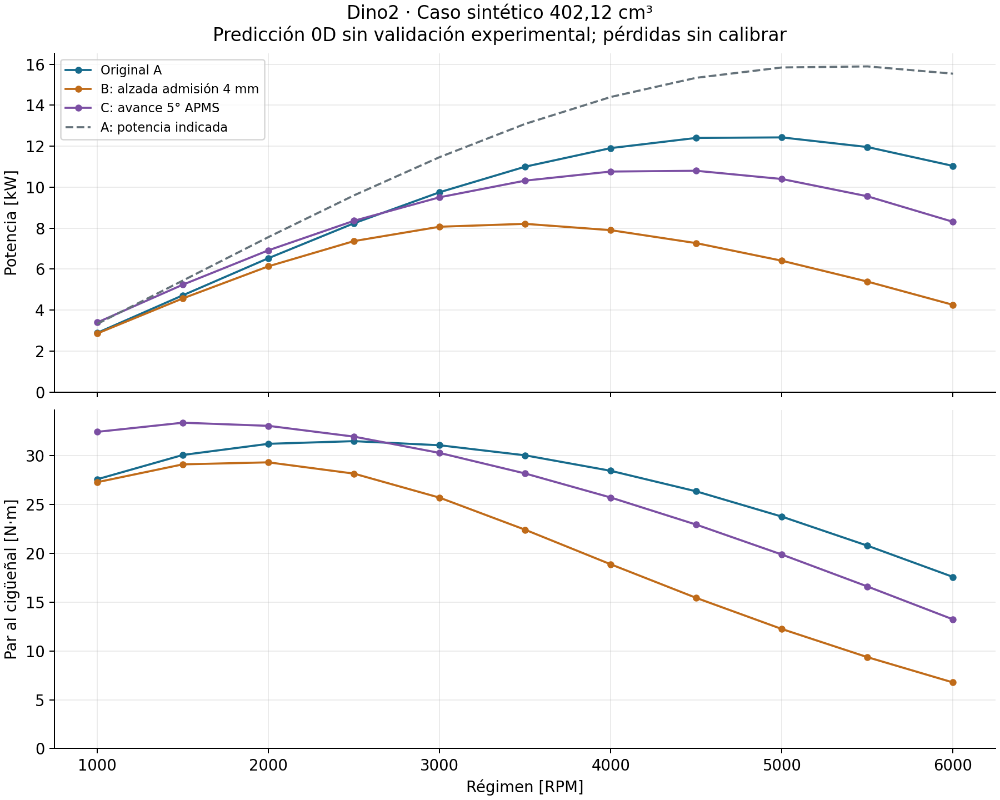
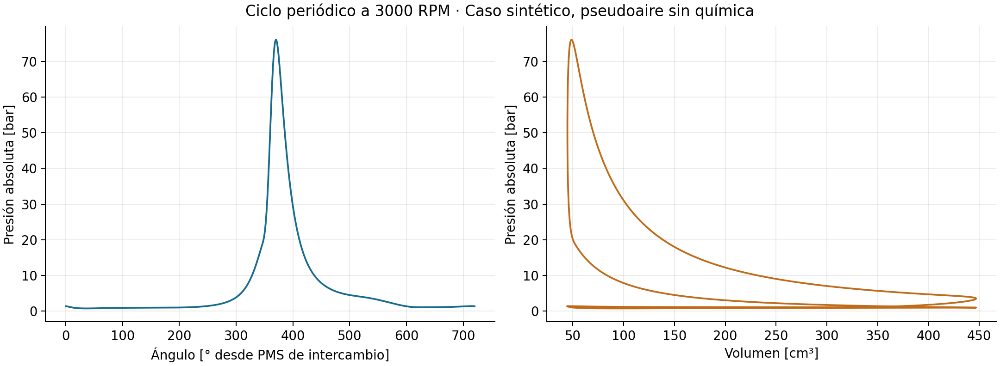
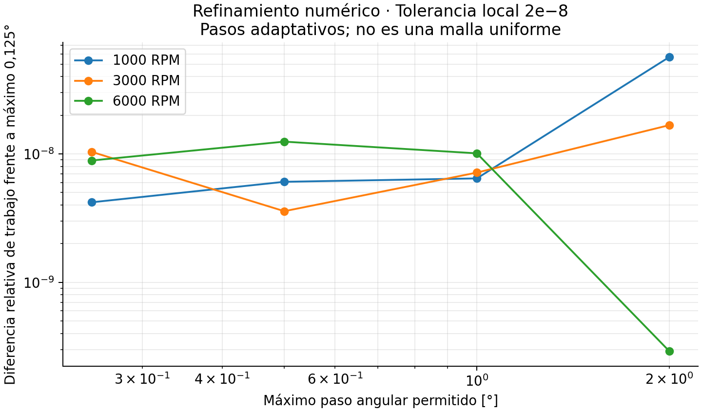

# Informe técnico — simulador físico 4T de Dino2

Entrega local del 19 de noviembre de 2026. Desarrollo desde `main` de etapa 0, sin modificar el Dino anterior ni hacer push. Tecnología conservada: C#, WPF y .NET 10. Este informe describe una **capacidad 0D funcional y verificada numéricamente**, no una validación experimental de predicciones de motores reales.

## Resultado funcional

La aplicación Windows configura un monocilíndrico 4T y calcula curvas indicadas y al cigüeñal por regímenes independientes hasta convergencia periódica. Se editan diámetro, carrera, biela, compresión, diámetro/cantidad/alzada/distribución/Cd de válvulas, depósitos, avance, duración y retraso de combustión, combustible, paredes, pérdidas mecánicas y resolución. Las gráficas no usan puntos de potencia prefijados ni factores de forma ajustados con RPM.

Se puede conservar el motor original A, modificar el actual B y comparar ambas curvas y diferencias al cigüeñal por RPM. A permanece intacto durante la edición. Los proyectos JSON conservan ambas configuraciones y permiten recalcularlas al abrir. La interfaz incluye presión frente al ángulo, p–V y diagnósticos; exporta curvas, traza del régimen seleccionado, original y comparación. El trabajo corre fuera del hilo gráfico, con cancelación y sin publicación de curvas parciales.

El Otto ideal sigue disponible como referencia independiente mediante su botón, CLI, JSON y pruebas originales. Sus ecuaciones no se modificaron.

## Modelo y decisiones científicas

Se implementaron balances abiertos de masa y energía de un cilindro homogéneo, mecanismo biela-manivela exacto centrado, válvulas con alzada sin² y tobera compresible con bloqueo sónico/reflujo, combustible contenido en mezcla fresca, calor finito Wiebe, transferencia Hohenberg y FMEP de forma Chen–Flynn. Se calcula trabajo neto en 720°, partición geométrica de bombeo/bruto, pérdidas, BMEP y aire fresco retenido.

El gas usa cp(T) de polinomios NASA para pseudoaire fijo; no resuelve composición de productos. La velocidad de combustión se prescribe mediante duración temporal y retraso, sin predecir su variación con turbulencia, mezcla o residuales. Las válvulas descargan hacia depósitos sin ondas. La fricción de ejemplo se transfiere de otro trabajo, con la incertidumbre de unidades de su término cuadrático expresamente documentada. Ningún parámetro de este ejemplo está calibrado mediante ensayos propios del motor.

Las ecuaciones, unidades, supuestos, fuentes y dominio numérico están en [modelo-4t.md](modelo-4t.md). La separación entre física, integración, controlador e interfaz está en [arquitectura-4t.md](arquitectura-4t.md).

## Resultados del caso reproducible

Entrada: `examples/4t-400cc.json`, 402,12386 cm³, diámetro/carrera 80/80 mm, biela 135 mm, compresión 10:1, admisión 100 kPa/320 K, escape 105 kPa/800 K. Admisión 32 mm y 8 mm de alzada, abierta de −10° a 220°; escape 28/7 mm, de 500° a 730°. Avance 20°, retraso 0,3 ms, duración 2 ms, AFR 14,7 y PCI 43 MJ/kg. Estos son datos de un escenario sintético.

| RPM | Pi [kW] | Pb estimada [kW] | Tb [N·m] | BMEP [bar] | VE |
|---:|---:|---:|---:|---:|---:|
| 1000 | 3,323 | 2,886 | 27,563 | 8,613 | 0,88996 |
| 2500 | 9,599 | 8,237 | 31,463 | 9,832 | 0,88232 |
| 3000 | 11,466 | 9,752 | 31,042 | 9,701 | 0,87239 |
| 5000 | 15,845 | 12,430 | 23,739 | 7,418 | 0,79871 |
| 6000 | 15,542 | 11,037 | 17,566 | 5,489 | 0,73158 |

En la malla de 500 RPM, el máximo de Pb queda en 5000 RPM y el máximo de Tb en 2500 RPM. No se interpoló un óptimo ni se identifica un régimen seguro del motor. La caída de llenado, el tiempo disponible, el desplazamiento angular del calor y las pérdidas explican la variación; no se impone la forma de una curva.



Para cambios aislados, sin recalibrar otros parámetros:

| RPM | ΔPb al reducir alzada de admisión 8→4 mm [kW] | ΔPb al reducir avance 20→5° [kW] |
|---:|---:|---:|
| 1000 | −0,031 | +0,508 |
| 3000 | −1,685 | −0,247 |
| 6000 | −6,785 | −2,730 |

Estas diferencias verifican sensibilidades de los mecanismos representados. No son ganancias/pérdidas experimentales ni una recomendación de preparación. El modelo de duración fija en segundos influye especialmente en la sensibilidad al avance entre regímenes.



## Conservación y referencias independientes

Compilación Release: 0 advertencias y 0 errores. Pasaron 13 grupos originales de Otto/archivos, 15 grupos 4T y 20 comprobaciones de ventana (10 Otto y 10 4T).

Las pruebas 4T cubren cinemática frente a derivadas independientes, cp/energía/inversión, geometría de válvulas, caudal sónico calculado como densidad sónica × velocidad sónica, reversión de flujo, normalización de Wiebe, orden RK4 frente a exp(x), compresión adiabática frente a integral de entropía, unidades de pérdidas, ciclo periódico, partición del trabajo, barridos, cambios físicos, cancelación, no convergencia, arrastre sin combustible, límites de RPM, archivos A/B, regresión y rendimiento.

En el barrido canónico, los mayores residuales internos observados son aproximadamente 1,3e−18 kg para masa y 2,7e−12 J para energía. Son cierres de cuadraturas integradas con el estado; no son una estimación independiente del error del solver.

Una segunda implementación en Python, sin importar Dino2, reconstruye geometría, propiedades, caudales, entalpías y calor de pared desde el snapshot y la traza exportada. A 3000 RPM, usando trapecios sobre 1454 muestras:

| Comprobación independiente | Resultado observado |
|---|---:|
| Trabajo ∮p·dV | 458,642284 J |
| Trabajo de cuadratura RK4 | 458,650011 J |
| Diferencia de trabajo | −0,007728 J |
| Residual independiente de masa | 7,74e−10 kg |
| Residual independiente de energía | −0,009048 J |

El calor liberado es aproximadamente 1057,096 J/ciclo. El residual independiente de energía es de alrededor del 0,00086% de este calor. La prueba permite 0,1% para la cuadratura trapezoidal; el trabajo debe diferir menos de 0,03 J. No se confunden estos errores con incertidumbre experimental.

## Convergencia temporal/angular y entre ciclos

Se ensayaron máximos angulares de 2°, 1°, 0,5°, 0,25° y 0,125° a 1000, 3000 y 6000 RPM, con tolerancia local 2e−8. El paso efectivo es adaptativo y los eventos fuerzan fronteras adicionales. En grados, dt=dθ/(6·RPM); 0,5° representa como máximo 83,33 µs a 1000 RPM y 13,89 µs a 6000 RPM, con dos subpasos RK4 por paso aceptado.

Comparando máximo 0,5° contra 0,125°, con igual tolerancia local:

| RPM | Diferencia relativa de Wi | Diferencia relativa de presión pico | Diferencia absoluta VE |
|---:|---:|---:|---:|
| 1000 | 6,1e−9 | 7,1e−6 | 2,8e−10 |
| 3000 | 3,6e−9 | 1,8e−7 | 3,2e−9 |
| 6000 | 1,3e−8 | 1,1e−5 | 1,1e−8 |

El control local puede reducir el paso mucho más que el máximo; estas diferencias no forman una secuencia monótona ni permiten inferir orden global solo cambiando el máximo. La prueba independiente del integrador confirma orden cuatro en un problema suave. También se comparó el ajuste predeterminado 0,5°/2e−7 frente a 0,25°/2e−8 a 3000 RPM: diferencia de trabajo aproximadamente 2,1e−5 J. Las aserciones de regresión de sensibilidad permiten hasta 0,3% en trabajo, 0,5% en pico y 0,001 absoluto en VE para los tres regímenes ensayados. Esos umbrales son controles de software, no precisiones físicas declaradas.



Periodicidad a 3000 RPM:

| Tolerancia periódica | Ciclos requeridos | Residual final relativo | Wi [J] |
|---:|---:|---:|---:|
| 1e−4 | 4 | 3,45e−6 | 458,649987 |
| 1e−6 | 6 | 4,32e−9 | 458,650011 |
| 1e−8 | 7 | 1,53e−10 | 458,650011 |

Se exige periodicidad de estado y trabajo por dos ciclos consecutivos. El caso de máximo tres ciclos falla explícitamente; no se presenta como resultado convergido. Hay pruebas de 500 y 10000 RPM, pero eso no establece viabilidad física de un motor en esos extremos.

## Rendimiento y cuellos de botella

Equipo: Intel Core i5-10400, 6 núcleos/12 procesadores lógicos, Windows 10 x64 build 19045, SDK .NET 10.0.404, runtime 10.0.15, compilación Release, cálculo secuencial. Se calentó JIT con un barrido previo; tres repeticiones de 11 regímenes dieron aproximadamente 527,1 / 510,5 / 500,6 ms, mediana **0,511 s**. Un proceso frío de CLI puede tardar más; se observó alrededor de 0,65 s para el solver tras cargar el proceso. No incluye compilación, arranque del proceso ni renderizado WPF.

El barrido requiere 106440 pasos aceptados, 1006 rechazados y 1289352 evaluaciones de balances. Las asignaciones por hilo bajaron de aproximadamente 35,65 MB a **7,37 MB** al conservar el delegado y usar muestras como valores, una reducción cercana al 79%. No se observó una mejora de tiempo que supere claramente el ruido de estas mediciones; no se atribuye una aceleración artificial a ese cambio.

Microcomprobaciones orientativas de 200000 llamadas, tras calentamiento:

| Operación | Tiempo aproximado |
|---|---:|
| u(T) + inversión a T | 19,0 ms |
| Caudal compresible | 21,6 ms |
| Cinemática | 6,8 ms |
| Balance completo en un estado de admisión | 81,6 ms |

El principal coste es la gran cantidad de evaluaciones requerida por el control de error y periodicidad, con potencias, trigonometría e inversión de propiedades dentro del balance. Estas mediciones aisladas no son porcentajes de un perfil de CPU del ciclo completo. Antes de cambiar correlaciones o tolerancias para ganar velocidad, se debe preservar la precisión ensayada; antes de paralelizar se debe medir un caso que lo necesite. La retención de trazas finales y su conversión a puntos domina parte de la memoria útil que permanece; todavía no se almacena una historia de todos los ciclos.

## Evidencia experimental disponible y limitaciones reales

**No se realizó validación experimental de Dino2.** Se identificó la colección [TCC-III de University of Michigan](https://volker-sick.engin.umich.edu/home/downloads), que ofrece geometría y mediciones para investigación. El acceso a su repositorio Deep Blue desde este entorno respondió HTTP 403; no se descargaron ni se utilizaron sus mediciones. La publicación sobre [ROTAX 912 S](https://www.mdpi.com/1996-1073/18/13/3440) contiene datos experimentales de otro motor/modelo. No se transfirieron sus cifras como si validaran el cilindro sintético de Dino2, ni se ajustaron parámetros para reproducirlas sin sus condiciones y representación física.

Las referencias consultadas justifican componentes y aproximaciones, no certifican las curvas obtenidas. La precisión predictiva permanece **sin cuantificar**. Aspectos prioritarios:

- El pseudoaire omite productos y disociación; el ejemplo supera 3000 K y puede sobreestimar temperaturas/presiones y trabajo.
- La combustión prescrita no predice duración, turbulencia, efectos de mezcla/residuales, fallos de encendido ni detonación. Cambiar avance representa la fase del calor dentro de esa ley.
- Los depósitos sin inercia/ondas y Cd constante restringen el uso para predecir modificaciones de admisión y escape. El modelo no permite evaluar longitudes de tubos.
- La transferencia térmica y, sobre todo, la potencia al cigüeñal dependen de correlaciones sin calibración del motor objetivo. La interpretación dimensional del coeficiente cuadrático transferido añade incertidumbre documentada.
- No hay multicilindro, 2T, optimización, emisiones ni verificación mecánica. No se ensayaron otras versiones de Windows ni escalas DPI distintas de la sesión local. Los diálogos nativos no forman parte de las pruebas internas de guardado/reapertura.

## Reproducir y revisar

```powershell
.\scripts\verify.ps1
python scripts/reference-4t.py
python scripts/plot-4t.py       # opcional; matplotlib 3.9.3 en esta entrega
.\scripts\publish.ps1
.\scripts\smoke-publish.ps1
```

`verify.ps1` usa SDK local si existe; en otra instalación requiere SDK .NET 10. Las pruebas son ejecutores de consola: `dotnet test` no los descubre. Usar `-SkipDesktop` solamente en Windows sin sesión gráfica, declarando que esa ejecución omite la UI. Python estándar basta para la comprobación independiente; matplotlib solo se utiliza para regenerar figuras del informe.

Los resultados completos se generan en `artifacts/4t-validation`: `baseline.csv`, `baseline-3000.trace.csv`, variantes, diferencias, `numerical-study.json`, `benchmark.json` y `kernel-benchmark.json`. Las capturas de la ventana se generan en `artifacts/verification`. Las cifras de rendimiento son una medición local, no una garantía para cualquier motor o equipo.

## Próximos incrementos recomendados

1. Incorporar un caso experimental trazable con geometría, alzadas, Cd, contornos y presión de cilindro. Separar datos de calibración y validación y cuantificar incertidumbre; empezar por arrastre/intercambio de gases antes de ajustar combustión.
2. Sustituir pseudoaire por propiedades de mezcla fresca/productos coherentes y verificar conservación de especies y energía química. Evaluar disociación según el dominio térmico; conservar este modelo como referencia reducida.
3. Mejorar combustión y transferencia térmica con parámetros identificables, comprobar sensibilidades cruzadas y limitar explícitamente los rangos predictivos. Calibrar pérdidas mecánicas contra ensayos de arrastre o información equivalente.
4. Añadir dinámica 1D de colectores cuando se pretenda evaluar longitudes, ondas y acoplamiento. Verificar primero problemas de ondas, estabilidad y conservación de uniones.

La comparación A/B ya está disponible. No se recomienda añadir optimización compleja ni 2T antes de mejorar y contrastar la capacidad predictiva de este 4T.
