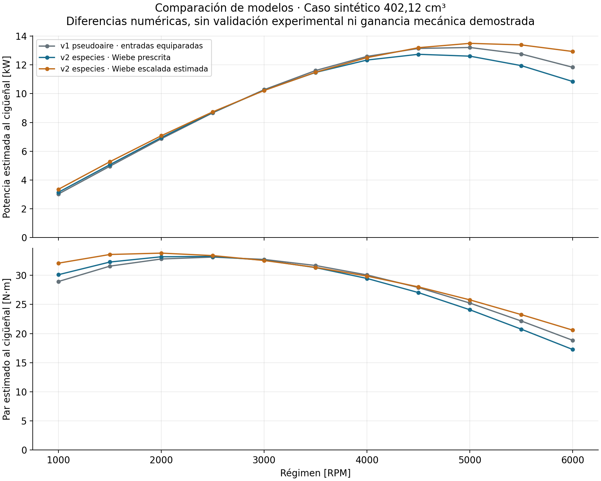
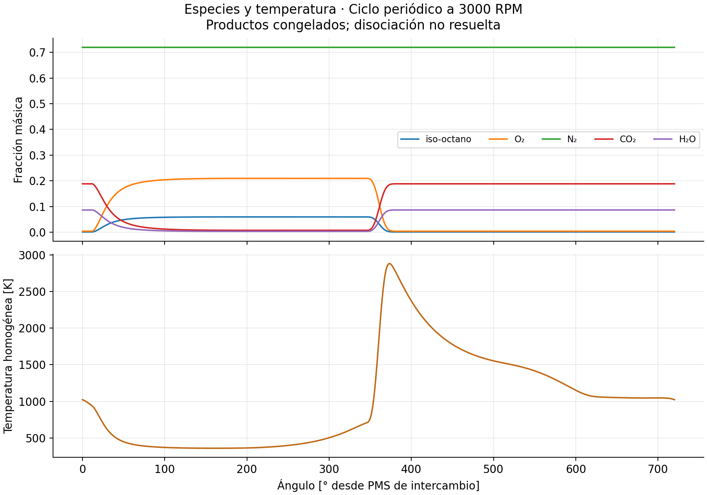
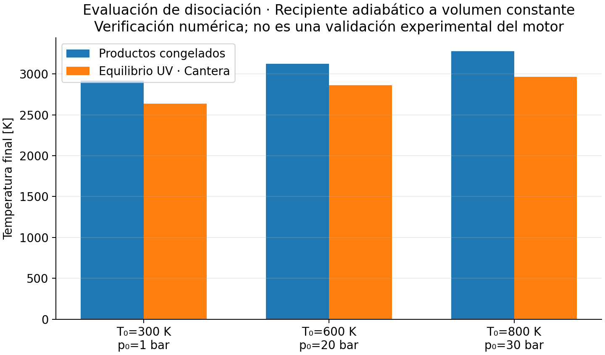

# Informe científico y técnico — etapa 2 de Dino2

19 de noviembre de 2026. Desarrollo desde `main` de etapa 1. Se entrega una formulación termoquímica de mayor fidelidad formal, aplicación Windows, pruebas y experimentos numéricos reproducibles. **No se declara precisión predictiva validada experimentalmente del motor.** La evaluación de equilibrio demuestra que la disociación omitida sigue siendo una limitación material del dominio caliente utilizado.

## Capacidad entregada y referencias conservadas

- Cinco especies explícitas: iso-octano gaseoso, O₂, N₂, CO₂ y H₂O. Conservación de masa, C/H/O/N y energía total con formación química; propiedades dependientes de T y composición, incluido R de mezcla.
- Transporte real de combustible y productos durante admisión, escape, reflujo y ciclos sucesivos. El combustible no convertido no desaparece: mantiene masa y entalpía química.
- Wiebe prescrita como referencia y Wiebe escalada mediante condiciones iniciales de combustión, mezcla y una aproximación de turbulencia identificada como estimada.
- Procedencia de parámetros estimados o declarados calibrados, guardada con los proyectos. Selección explícita del modelo en Windows, curvas, ciclo, diagnósticos y comparación A/B preservando el original.
- Comparación independiente con Cantera 3.2.0 y evaluación cuantitativa de equilibrio/disociación. Investigación de datos experimentales y protocolo que separa identificación y evaluación independiente.

El Otto ideal y `four-stroke-0d-air-v1` se conservan con sus ecuaciones y regresiones. El nuevo identificador es `four-stroke-isooctane-frozen-v2`. No se añadió 2T, solver 1D completo ni optimización compleja.

El dominio es deliberadamente concreto: mezcla previamente vaporizada de iso-octano puro y aire seco, 0,8≤φ≤1, productos completos congelados y cilindro homogéneo. No se lo presenta como química general de cualquier gasolina. Las ecuaciones, eventos y límites están en [modelo-termoquimico.md](modelo-termoquimico.md).

## Propiedades, energía química y revisión de pérdidas

Se usan polinomios NASA de especies con sus entalpías de formación, verificadas contra otra implementación. El balance es `ΔUtotal = Hflujo − Qpared − W`; **no se añade otra vez el PCI como calor**. El PCI del iso-octano gaseoso se deriva de la reacción a 298,15 K con H₂O vapor: aproximadamente **44,65014 MJ/kg**. El AFR estequiométrico para el aire 21/79 elegido es aproximadamente **15,03344 kg/kg**. Son resultados de datos termodinámicos y masas moleculares, no coeficientes escogidos para ajustar potencia.

La conversión por defecto es 0,98. En v2 significa fracción del combustible disponible que se convierte, con límite de oxígeno, y deja el resto en el balance. El diagnóstico `heat_released_J` representa conversión × PCI en base de entalpía a 298,15 K; no es un calor externo. La eficiencia utiliza combustible neto admitido. Esta contabilidad es distinta de la aproximación de carga encerrada y factor térmico de v1.

Se revisaron unidades de Hohenberg y Chen–Flynn. Sus implementaciones originales usan las unidades documentadas y sus pruebas siguen pasando. No se dispone de evidencia para corregir un coeficiente del motor objetivo mediante ajuste; se conserva la incertidumbre dimensional de la fuente del término cuadrático de fricción y se identifica su transferencia como estimada. No se ocultó esa incertidumbre cambiando coeficientes para dar una curva conveniente.

La interfaz distingue procedencia estimada o calibrada declarada por el usuario, fuente, identificador de datos y rango. Declarar calibración no ejecuta ni certifica un ajuste; no equivale a validación independiente. Los ejemplos son estimados. Editar los coeficientes de esos grupos en la interfaz invalida su estado de calibración declarado.

## Combustión y avance: mejora y límite

La duración escalada usa una correlación de velocidad laminar de iso-octano de Metghalchi–Keck y una escala de turbulencia `Ct·Up`, evaluadas en el estado no quemado al inicio de combustión. Se normaliza contra referencias fijas de T, p, equivalencia, residuo, tamaño y velocidad de pistón. La equivalencia de referencia no cambia silenciosamente al modificar AFR; hay una prueba para evitar que esa renormalización cancele la sensibilidad a mezcla pobre.

El avance modifica la fase del calor y las condiciones usadas para la duración. La geometría, llenado y residuo también influyen. **No es propagación de llama resuelta**: no calcula frente, área, kernel, entrainment, turbulencia dinámica ni extinción. El retraso de ignición sigue prescrito. Duración de referencia y Ct necesitan identificación del motor; 2 ms y Ct=0,3 son supuestos del ejemplo, no resultados de calibración.

Se muestran extrapolaciones de la correlación en diagnósticos y en el resumen de curvas. A 3000 RPM, el caso base llega a SOC con unos 705,5 K: supera ligeramente el límite térmico de 700 K del conjunto original. Variantes de compresión, avance o llenado pueden excederlo más. Aplicar el corrector de dilución fuera del caso estequiométrico ensayado añade otra extrapolación. Estar dentro de los límites numéricos tampoco valida la transferencia a residuos reales del motor.

La reproducción de los ajustes de velocidad publicados se guarda como `published-correlation-reproduction.json`. Es una comprobación del uso de una correlación ajustada a los mismos experimentos de origen; **no se cuenta como validación independiente del motor ni de la duración turbulenta**.

## Comparación reproducible con v1

Para separar cambios de formulación de cambios de entradas se ejecutó v1 con la misma geometría, contornos, AFR=15,03344, PCI=44,65014 MJ/kg y valor nominal 0,98. No se comparó sin aclaración contra el ejemplo histórico con AFR 14,7/PCI 43 MJ/kg/factor 0,95. La columna v2 prescrita conserva la ley temporal; la diferencia incorpora propiedades, composición, transporte y contabilidad química. La columna v2 escalada añade la nueva hipótesis de duración.

| RPM | Pb v1 equiparado [kW] | Pb v2 prescrita [kW] | Pb v2 escalada [kW] | T pico v1 [K] | T pico v2 escalada [K] |
|---:|---:|---:|---:|---:|---:|
| 1000 | 3,030 | 3,152 | 3,359 | 3494 | 3001 |
| 3000 | 10,277 | 10,237 | 10,219 | 3219 | 2881 |
| 6000 | 11,832 | 10,842 | 12,929 | 2712 | 2747 |

Las diferencias no prueban que una formulación esté experimentalmente más cerca de un motor, ni representan una ganancia de preparación. Sí muestran que no se ha supuesto que el cambio de modelo deba aumentar potencia o reducirla en todo el rango.



A 3000 RPM, el modelo escalado da aproximadamente Wi neto=477,07935 J/ciclo, Pi=11,92698 kW, Pb=10,21898 kW, Tb=32,52801 N·m y VE=0,919695. La duración completa normalizada es 33,88685°; CA10/50/90=353,80079°/361,13911°/368,86505°, con 0° en PMS de intercambio. CA10–90 no debe confundirse con la duración completa.



## Verificación de conservación y propiedades

Pasaron **37 grupos de pruebas**: 13 originales de Otto/archivos, 15 de 4T de referencia y 9 termoquímicos. Pasaron **25 comprobaciones de interfaz**: 10 Otto y 15 del editor/análisis 4T. Compilación Release sin advertencias ni errores.

Las nuevas pruebas cubren estequiometría y elementos, formación y PCI derivado, cp/h/u y su inversión, mezcla/composición/R, reacción adiabática cerrada a volumen constante, correlación de velocidad, combustión condicionada, ciclo abierto, especies y energía total, periodicidad, refinamiento, transporte de combustible no quemado, archivos/procedencia, cancelación y fallos explícitos. La referencia anterior conserva su regresión de 458,650011 J/ciclo a 3000 RPM.

En el caso nuevo de 3000 RPM se observaron cierres internos cercanos a:

| Residual interno | Magnitud aproximada |
|---|---:|
| Masa total | 6,4e−19 kg |
| Especie máxima | 2,7e−19 kg |
| Elemento máximo | 3,5e−19 kg |
| Energía total | 2,9e−12 J |

Estos son cierres de estados y cuadraturas compartidas, no una estimación independiente de precisión. Una segunda implementación usa propiedades de Cantera y flujos calculados mediante Mach/densidad/velocidad sónica, con trapecios sobre la traza exportada de 1466 muestras:

| Comprobación independiente a 3000 RPM | Resultado |
|---|---:|
| Mayor diferencia cp respecto a Cantera | 2,8e−12 J/(kg K) |
| Mayor diferencia h/u | 0,0271 J/kg |
| Mayor residual de especie por cuadratura de flujos | 3,01e−9 kg |
| Residual de energía total por cuadratura independiente | −0,00357 J |
| Trabajo integrado independientemente | 477,07132 J |
| Trabajo del solver | 477,07935 J |

La pequeña diferencia h/u procede de hacer continua la integral sensible en 1000 K frente a los ajustes NASA originales por intervalos. El trabajo independiente difiere unos 0,00803 J. La auditoría permite hasta 0,03 J en trabajo, 1 J en energía y 1e−7 kg por especie para esta discretización trapezoidal. Esas tolerancias no son incertidumbre experimental.

## Convergencia numérica y periódica

A 3000 RPM se compararon máximos de 1°, 0,5°, 0,25° y 0,125°, con tolerancia local 2e−8. La diferencia entre 0,5° y 0,125° fue de unos 5,0e−6 J en trabajo, 61,5 Pa en presión pico (8,2e−6 relativo) y 9,4e−9 absoluto en VE. El ajuste predeterminado 0,5°/2e−7 difirió unos 9,4e−5 J de la referencia fina. Los pasos son adaptativos y se cortan en eventos; no se infiere orden global de una malla uniforme a partir de estas diferencias no monótonas. La prueba analítica RK4 de etapa 1 se conserva.

| Tolerancia periódica | Ciclos | Residual final | Wi [J] |
|---:|---:|---:|---:|
| 1e−4 | 5 | 2,08e−7 | 477,079351 |
| 1e−6 | 6 | 5,81e−9 | 477,079354 |
| 1e−8 | 7 | 1,60e−10 | 477,079354 |

La condición periódica incluye cada especie, energía total, marcador de carga y trabajo. Se requiere repetición durante dos ciclos consecutivos. La cancelación y el límite de tres ciclos no publican resultados parciales o falsamente convergidos.

## Evaluación de disociación: necesaria para mayor precisión caliente

Cantera se usa como herramienta independiente de investigación, no como dependencia ni factor corrector de la aplicación. Se compararon productos congelados y equilibrio UV en recipientes adiabáticos cerrados, conservando elementos, energía y volumen:

| Estado fresco inicial | T final congelada [K] | T final equilibrio [K] | Diferencia [K] |
|---|---:|---:|---:|
| 300 K, 1 bar | 2917,62 | 2634,77 | 282,85 |
| 600 K, 20 bar | 3124,63 | 2865,33 | 259,31 |
| 800 K, 30 bar | 3279,22 | 2965,13 | 314,09 |



También se ejecutó un caso de motor con conversión completa para no confundir combustión de combustible remanente con disociación. En una muestra inmediatamente posterior al final de combustión, a 379,2733°, el estado congelado tenía 2842,88 K y 62,2503 bar. Reevaluar instantáneamente esos productos mediante equilibrio UV da 2664,87 K y 58,9811 bar: **178,01 K y aproximadamente 5,25% de presión de diferencia**. Aparecen CO y H₂ con fracciones molares aproximadas de 0,01557 y 0,00291.

Es una evaluación instantánea, no un ciclo de motor con equilibrio acoplado ni una validación experimental. Demuestra que el error de química congelada es potencialmente mucho mayor que el error de integración medido. No se aplica un multiplicador para ocultarlo. Para declarar mayor precisión térmica/predictiva en este dominio es necesario incorporar una representación adecuada de disociación/productos y contrastarla, teniendo en cuenta también congelamiento químico durante expansión y escape.

## Sensibilidades de modificaciones

Se estudiaron avance, compresión, alzada, distribución, presión y temperatura de admisión/escape en 1000, 3500 y 6000 RPM. Las variantes y sus diagnósticos se guardan en `sensitivities.json` y CSV separados. Como muestra, a 3500 RPM respecto al caso base:

| Cambio aislado | ΔPb estimada [kW] |
|---|---:|
| Avance 20→5° | −0,545 |
| Avance 20→35° | −1,197 |
| Compresión 10→8 | −0,862 |
| Compresión 10→12 | +0,611 |
| Alzada admisión 8→4 mm | −3,114 |
| Cierre admisión 220→260° | −0,966 |
| Presión admisión 100→80 kPa | −2,948 |
| Presión escape 105→125 kPa | −0,263 |
| Temperatura admisión 320→300 K | +0,845 |
| Temperatura escape 800→900 K | ≈0 (inferior a resolución numérica) |

No son ganancias o pérdidas mecánicas demostradas. El signo y magnitud son respuestas de este modelo y sus parámetros estimados. El avance cambia la fase de trabajo y el estado que gobierna duración; no identifica por sí solo MBT ni detonación. La compresión cambia trabajo, temperatura, pérdidas y duración; las variantes calientes pueden extrapolar la correlación de velocidad. La alzada modifica área efectiva y llenado. El cambio de cierre altera la historia completa del perfil sin² idealizado y el reflujo, no una leva medida con el resto del perfil idéntico. Los contornos cambian densidad, entalpía, bombeo y residuos.

Una temperatura de escape impuesta solo actúa como condición del donante cuando hay flujo hacia el cilindro, además de inicializar el cálculo. No se fuerza una respuesta si el escape es exclusivamente saliente o si la diferencia queda debajo de la sensibilidad numérica; no se ha incorporado intercambio térmico con un tubo real.

Las diferencias de trabajo de las variantes a 3500 RPM se recalcularon con máximo 0,25° y tolerancia local 2e−8 frente al ajuste predeterminado. La mayor diferencia entre sensibilidades fue aproximadamente **1,6e−4 J/ciclo**, muy inferior al umbral de prueba de 0,05 J. Eso demuestra resolución numérica de esas diferencias, no exactitud física frente a las incertidumbres de química, combustión o calibración.

## Calibración y validación experimental

**No se calibraron parámetros con un motor experimental ni se cuantificó un error predictivo experimental de Dino2.** La evidencia y las decisiones sobre datasets están en [validacion-experimental.md](validacion-experimental.md). Se revisaron TCC-III, un ZIP ETRF accesible, conjuntos de presión de metano/dual-fuel y un conjunto de datos CFD. Acceso incompleto, combustibles distintos, datos agregados o resultados simulados impiden usarlos como validación independiente suficiente del modelo implementado.

El protocolo separa datos de identificación y validación por puntos/campañas completos, define requisitos de sensores/contornos/combustible, métricas de presión/IMEP/CA50/par y propagación de incertidumbres. Una etiqueta de calibración en la aplicación es procedencia declarada, no un certificado. Una correlación respaldada por ensayos publicados no calibra automáticamente el motor configurado.

Por lo tanto: verificación numérica **realizada**, calibración experimental propia **no realizada**, validación experimental de motor **no determinada**. No se sustituye esta última por datos sintéticos ni por concordancia entre programas.

## Rendimiento y regresiones

Medido en Intel Core i5-10400, Windows 10 x64 build 19045, SDK .NET 10.0.404/runtime 10.0.15, Release y ejecución secuencial. Tras calentamiento, tres barridos nuevos de 11 regímenes requirieron aproximadamente 1,073 / 1,087 / 1,172 s: mediana **1,09 s**. Se asignaron aproximadamente **9,9 MB por barrido**. Hubo 100159 pasos aceptados y 1216896 evaluaciones de balances.

La referencia de pseudoaire en esta versión requirió alrededor de 0,54 s para su ejemplo de 11 RPM. Son cargas de aplicación con física distinta, no un benchmark de una ecuación aislada. El coste adicional corresponde principalmente al mayor estado y a evaluar/invertir propiedades de cinco especies repetidamente; esto se infiere de las operaciones y contadores, no de un perfil CPU instrumentado. La extensión común de muestras para incluir composición también aumenta la memoria de trazas de referencia respecto a la entrega histórica. No se observa una regresión numérica de esa referencia.

No se añadió paralelismo ni una dependencia nativa en producción. La aplicación ejecuta el cálculo fuera del hilo gráfico, permite cancelar y publica solo soluciones completas. Las pruebas verifican que A persiste al editar B, que el proyecto reproduce ambas curvas, que v1 sigue disponible, que el PCI reactivo es derivado y que una comparación entre modelos lo declara.

## Ejecutable, pruebas y resultados reproducibles

Abrir `artifacts/win-x64/Dino2.Desktop.exe` o extraer todo `artifacts/Dino2-win-x64.zip`. La distribución incluye runtime, ejemplos y documentación. La aplicación no requiere Python ni Cantera.

```powershell
.\scripts\verify.ps1
dotnet run --project src/Dino2.Cli -c Release -- --4t examples/4t-isooctane.json curvas.csv traza.csv
.\scripts\publish.ps1
.\scripts\smoke-publish.ps1
```

Si solo está instalado el SDK global 9, los scripts usan automáticamente el SDK local de `.tools/dotnet` cuando existe. `dotnet test` no ejecuta los programas de aserciones: debe usarse `verify.ps1`. Sin escritorio interactivo, `-SkipDesktop` omite las comprobaciones WPF y así debe declararse.

Verificación científica adicional, opcional:

```powershell
python -m venv .tools/science
.\.tools\science\Scripts\python.exe -m pip install cantera==3.2.0
.\.tools\science\Scripts\python.exe scripts/check-stage2-cantera.py
python scripts/plot-stage2.py    # opcional, matplotlib 3.9.3 usado para las figuras
```

`artifacts/stage2` contiene vectores de propiedades, casos cerrados, convergencia, sensibilidades, comparación v1/v2, trazas, benchmark y `cantera-assessment.json`. Los tiempos cambian con equipo/carga; las magnitudes físicas del mismo modelo y configuración son deterministas. `artifacts/verification` contiene capturas y pruebas de apertura/guardado/A–B. Los ejemplos y documentos se incluyen en el ZIP; los artefactos generados no se suben a Git.

## Siguiente desarrollo recomendado

Priorizar una formulación de productos/disociación coherente con el dominio caliente y su acoplamiento conservativo, y conseguir un caso experimental suficientemente identificado dentro del combustible y régimen soportados. Después identificar combustión, transferencia y pérdidas por separado y evaluar datos no usados en la identificación. Una representación de gas no quemado/quemado y turbulencia más física debe incorporarse con pruebas propias, sin llamar propagación de llama a la ley actual.

La arquitectura permite esa progresión manteniendo v1 y v2 como referencias. No corresponde añadir 2T, optimización compleja ni un solver 1D completo para ocultar las limitaciones predictivas aún abiertas.
