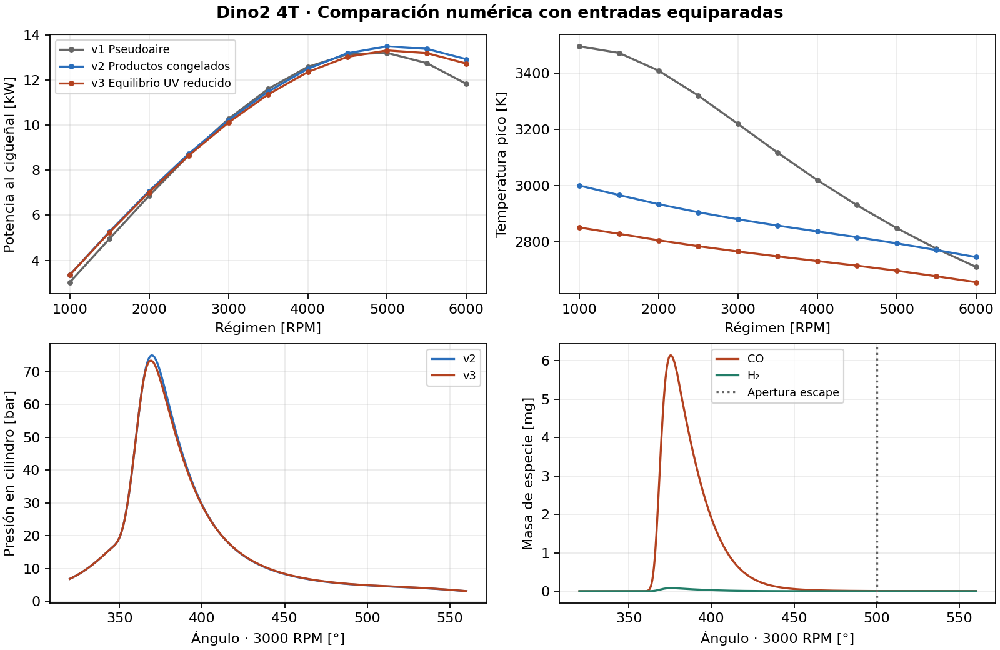

# Dino2 4T · Etapa 3

Dino2 v3 incorpora disociación de CO₂ y H₂O en el cilindro. Conserva Otto, pseudoaire v1 y productos congelados v2 como referencias ejecutables. El caso v3 viene seleccionado al abrir la aplicación. Los archivos anteriores conservan su modelo y se pueden usar como A al comparar.

## Formulación

Se mantienen el cilindro homogéneo 0D, el iso-octano previamente vaporizado, aire seco y φ de 0,8 a 1. La ley Wiebe seleccionada determina la cantidad de combustible convertida. La distribución de productos se resuelve a partir de ese inventario, dejando inerte el combustible restante. Se añaden CO y H₂ con propiedades NASA7 del mismo conjunto que v2. N₂ permanece inerte en producción.

Las dos reacciones son CO₂ ⇌ CO + ½O₂ y H₂O ⇌ H₂ + ½O₂. Forman una base que también permite el desplazamiento agua-gas dentro del conjunto reducido. A T fija se calculan Kc y Kh con las energías de Gibbs estándar a p° = 101325 Pa. Con q = √(pO₂/p°), los moles de CO y H₂ son C·Kc/(q+Kc) y H·Kh/(q+Kh), donde C y H representan los inventarios molares de los pares carbonado e hidrogenado. El balance de oxígeno es

```text
q²/a = O + (nCO + nH2)/2
a = R·T/(V·p°)
O = nO2 inicial − (nCO inicial + nH2 inicial)/2
```

El residual escalar crece con q. Newton con acotamiento resuelve ese balance y otra iteración de Newton acotada impone U = Σ mi·ui(T), con derivada que incluye la variación de composición. El volumen viene de la cinemática. La presión usa la suma de moles actual. Se conserva el balance dU = dHflujo − dQpared − p·dV con entalpías de formación, como en v2. La disociación consume energía sensible y la recombinación puede devolverla durante expansión. El diagnóstico de PCI sigue midiendo conversión nominal de combustible, en tanto que U y h representan la energía efectivamente repartida entre especies.

El cálculo UV se aplica desde SOC hasta EVO en el tramo de válvulas cerradas cuando hay consumo de combustible. En cada etapa de integración, la composición algebraica determina p y transferencia térmica. Al abrir el escape se guarda esa composición y sus dos extensiones netas de reacción, y se transportan CO y H₂ junto con las demás especies. La admisión y el escape mantienen los depósitos de composición fija de v2. Un motor sin conversión conserva composición congelada durante todo el ciclo.

EVO proporciona una transición reproducible entre el cálculo de recombinación en volumen cerrado y el transporte durante el escape. La aproximación representa recombinación rápida durante toda la expansión cerrada, aunque en un motor real el enfriamiento puede congelar la composición antes. La zona caliente se mezcla con el gas no quemado en un único estado térmico. Para cinética reducida o un criterio de congelamiento por tiempos químicos hacen falta un mecanismo aplicable y datos sobre temperatura, composición y tiempos de residencia. La concentración calculada al escape queda condicionada por esta elección y carece de validación como emisión. El equilibrio ampliado evaluado abajo también supone velocidades de reacción infinitas. En especial, su NO indica una sensibilidad termoquímica y no la concentración que alcanzaría el motor.

Fuentes: [NASA RP-1311, equilibrio UV](https://ntrs.nasa.gov/citations/19950013764), [coeficientes NASA7 en Cantera 3.2.0](https://github.com/Cantera/cantera/blob/v3.2.0/data/nasa_gas.yaml), [documentación v2 y fuentes de combustión y pérdidas](modelo-termoquimico.md).

## Verificación

La suite conserva las regresiones previas y agrega cuatro grupos para recipientes UV, ciclo abierto y A/B, convergencia y sensibilidades. A 3000 RPM v3 cerró masa a 1,8e−19 kg y energía a 2,2e−12 J en los integrales internos. Las pruebas también verifican el balance por especie usando las extensiones de reacción y los flujos integrados, el cierre elemental, la energía reconstruida de cada estado exportado, el trabajo con trapecios p–V y la persistencia de CO entre ciclos. En el ejemplo, CO pasa de 6,14 mg a 375,1° a 0,0051 mg a EVO. La magnitud de esa recombinación depende del límite de equilibrio adoptado.

Con máximos angulares de 1°, 0,5°, 0,25° y 0,125°, tolerancia local 2e−8 y periódica 1e−8, el trabajo se mantuvo entre 472,6362698 y 472,6362861 J. Se necesitaron 7–8 ciclos y el mayor residual periódico final fue 3,4e−10. Entre 0,5° y 0,125° el pico muestreado cambió 1,43 kPa (0,020 %) y 0,096 K. Los máximos muestreados dependen de la malla y la comparación no presupone convergencia monótona. Con los ajustes de interfaz, el trabajo difirió de la malla más fina en 0,000057 J.

La implementación independiente de Cantera 3.2.0 reconstruye nueve recipientes adiabáticos UV con φ = 0,8 / 0,95 / 1 y estados iniciales de 300 K y 1 bar, 600 K y 20 bar, y 800 K y 30 bar. Para las mismas especies, las mayores diferencias fueron **6,9e−7 K**, **2,0e−10 de presión relativa** y **7,2e−10 de fracción másica**. También reprodujo seis estados instantáneos del cilindro entre 355° y 499°. Ambos cálculos comparten las fuentes NASA7 y usan algoritmos de equilibrio distintos.

Ampliar el equilibrio de referencia con OH, O, H y NO bajó T entre **45 y 77 K** adicionales en los recipientes. En la muestra de motor a 380,1°, los radicales redujeron 23,2 K y permitir NO añadió otros 16,8 K. Juntos redujeron la presión alrededor de 1,34 %. En la muestra de 499,1°, la diferencia total de T fue de 0,84 K. Este contraste cuantifica el efecto de añadir especies localmente a U y V fijos. Para cuantificar su efecto sobre el trabajo haría falta recalcular el ciclo completo con la química ampliada.

## Comparación y sensibilidades

Las curvas comparten geometría, válvulas, contornos, AFR y PCI. v2 y v3 comparten Wiebe escalada y definición de conversión. v1 usa el mismo valor numérico para su factor de liberación térmica, con su significado original. El caso ilustrativo es de 402,12 cm³.

| RPM | Pb v1 [kW] | Pb v2 [kW] | Pb v3 [kW] | ΔWi v3−v2 [J] | ΔT pico [K] | Δp pico [bar] |
|---:|---:|---:|---:|---:|---:|---:|
| 1000 | 3,030 | 3,359 | 3,354 | −1,49 | −148,8 | −3,50 |
| 3000 | 10,277 | 10,219 | 10,118 | −4,44 | −114,1 | −1,61 |
| 6000 | 11,832 | 12,929 | 12,734 | −4,04 | −89,1 | −0,54 |



A 3000 RPM v3 redujo la potencia indicada 111 W y la pérdida mecánica estimada 10 W. El efecto neto en el cigüeñal fue −101 W. La mayor reducción de temperatura que de trabajo es compatible con una devolución de energía química durante expansión y menor calor a paredes, de 211,46 a 209,39 J/ciclo.

Se varió una cantidad por vez en 1000, 3500 y 6000 RPM. Estos cambios de Pb respecto de la base de cada modelo ilustran el caso de 3500 RPM.

| Modificación | v2 [W] | v3 [W] |
|---|---:|---:|
| Avance 20° → 5° | −545 | −553 |
| Compresión 10 → 12 | +611 | +621 |
| Alzada de admisión 8 → 4 mm | −3114 | −3092 |
| Duración de referencia +10 % | +5,4 | +5,1 |
| Coeficiente de velocidad turbulenta +20 % | +0,6 | +0,5 |
| Conversión 0,98 → 0,95 | −402 | −359 |
| Multiplicador Hohenberg +20 % | −261 | −244 |
| Constante FMEP +20 kPa | −235 | −235 |

La refinación a 0,25° y tolerancias 2e−8 locales / 1e−8 periódicas reproduce los cambios de Pb de v3 dentro de 0,1 W. En este caso aumentar duración retrasó CA50 aproximadamente 1,6° y redujo levemente el trabajo indicado, mientras que la menor presión redujo la fricción prevista. El cambio de constante FMEP mueve solo la curva al cigüeñal exactamente en −ΔFMEP·Vd·RPM/120. El coeficiente turbulento actúa tanto en el numerador de referencia como en las condiciones actuales. Su sensibilidad local pequeña no lo identifica. Los números corresponden al ejemplo y a los coeficientes estimados de la etapa anterior. No se ajustó otro subsistema para compensar las diferencias.

## Calibración y evidencia experimental

Geometría, distribución y alzada de válvulas, presión y temperatura de admisión/escape y avance son medibles. Para caracterizar el llenado convienen curvas de caudal de válvulas y presiones resueltas por ángulo. CA10/50/90 e IMEP indican qué aspectos de Wiebe ajustar a partir de presión calibrada y fase de PMS. Temperatura de paredes, flujo térmico o ensayos arrastrados con contornos conocidos ayudan a separar transferencia térmica de combustión. Par medido junto a trabajo indicado permite identificar FMEP frente a carga y régimen. La duración de referencia, el coeficiente de turbulencia, la conversión, transferencia de Hohenberg y coeficientes de fricción del ejemplo siguen siendo estimaciones. La interfaz conserva las fuentes declaradas y vuelve a marcar los tres grupos como estimados al cambiar de modelo.

| Fuente experimental | Utilidad y limitación |
|---|---|
| [Darmstadt, caso estable y caso inestable](https://link.springer.com/article/10.1007/s10494-022-00353-7) | El estable usa iso-octano estequiométrico, 1500 RPM, 0,4 bar y motor 86×86 mm de compresión 8,7. El artículo informa fase y presión. El inestable incorpora 12,9 % EGR y ciclos alternados, fuera del alcance del v3 periódico. Las figuras y tablas no constituyen trazas crudas con los contornos y par necesarios para evaluar todas las salidas. |
| [Tesis de Schmidt, puntos A–F](https://doi.org/10.26083/tuprints-00026620) | Informa condiciones, geometría y gráficas de presión de cilindro, admisión y escape. Es candidata para definir una campaña de contraste; no se recuperó un paquete reproducible de trazas y par para los puntos compatibles. |
| [High EGR Database](https://doi.org/10.48328/tudatalib-1532) | El catálogo identifica contornos y diagnósticos de ciclos. El registro marca acceso restringido a archivos. Además, los casos con EGR externo y encendido salteado requieren una configuración que v3 no reproduce. |
| [Argonne, CFR con PRF100](https://www.osti.gov/servlets/purl/1501884) | Publica geometría y describe presión de cilindro y puertos resuelta por ángulo. Es un trabajo de combustión con detonación; parte del análisis utiliza la presión medida para reconstruir condiciones del modelo. No se encontraron trazas crudas de puntos compatibles junto con par y contornos suficientes. |
| [Bosch Engine Datasets](https://github.com/boschresearch/Bosch-Engine-Datasets) | Contiene mediciones de par y variables agregadas de un motor de gasolina. Sin traza de presión del cilindro y condiciones reproducibles de iso-octano para esta formulación. |

Se conserva el protocolo de [validación experimental](validacion-experimental.md). Si se obtienen las trazas compatibles, la separación debe fijarse por puntos completos antes de ajustar. Conservar un grupo para identificación de combustión y pérdidas, y reservar otros avances, cargas y RPM para evaluar presión angular, CA50, IMEP y potencia. FMEP se aplica después de calcular el ciclo, de modo que ajustarlo modifica el par estimado y deja intacto el error de presión. Cambiar Hohenberg para absorber un error de composición sí podría sesgar una calibración y requiere evidencia térmica independiente.

**Verificación numérica completada. Calibración experimental propia pendiente. Validación experimental de motor pendiente.** No hay estimación de error predictivo frente a un motor real en esta entrega.

## Ejecución y rendimiento

Abrir Dino2.Desktop.exe tras extraer completo el ZIP de Windows. El paquete incluye runtime .NET 10, ejemplos y documentación. El estudio usa 41 grupos de pruebas C# y 25 comprobaciones de interfaz WPF. En el barrido caliente de 11 RPM, la mediana fue de aproximadamente 1,9 s y se asignaron 10,9 MB en este equipo. v2 ronda 1,1 s. Ambos casos hacen cerca de 1,2 millones de evaluaciones del balance, con inversión termoquímica más costosa en v3. Este coste permite mantener el solver directo, sin tablas interpoladas ni dependencias de producción.

```powershell
.\scripts\verify.ps1
.\.tools\science\Scripts\python.exe scripts/check-stage3-cantera.py
python scripts/plot-stage3.py
.\scripts\publish.ps1
.\scripts\smoke-publish.ps1
```

El script independiente requiere Cantera 3.2.0. El gráfico requiere matplotlib. Los datos y CSV se generan en artifacts/stage3. El archivo v2-v3-project.json conserva ambas configuraciones a 3000 RPM para reproducir la comparación en la aplicación.
