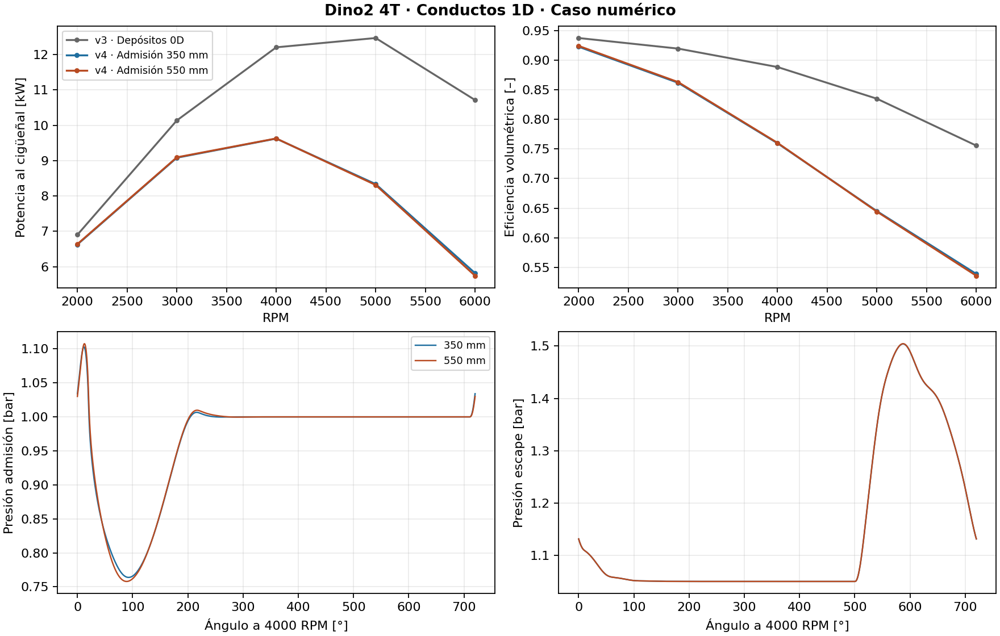

# Dino2 4T · Etapa 4 · Conductos 1D

El modelo v4 añade un conducto de admisión y otro de escape al cilindro v3 de equilibrio reducido. Cada conducto une su depósito exterior con su válvula. Los dos extremos tienen diámetros editables, con diámetro interpolado linealmente entre ellos. Longitud, resolución y CFL se guardan en las configuraciones A y B. El modelo de depósitos 0D v3 y las referencias v1, v2 y Otto siguen disponibles.

## Formulación física y numérica

Se resuelven las ecuaciones de Euler cuasi-1D para un ducto fijo de sección A(x):

```text
 ∂(A U)/∂t + ∂(A F)/∂x = (0 por especie, p·dA/dx, 0 energía, 0 marcador)
 U = (ρY₁, ..., ρY₇, ρu, ρE, ρYf)
 F = (ρuY₁, ..., ρuY₇, ρu²+p, u(ρE+p), ρuYf)
 E = e(T,Y) + u²/2
 p = ρ R(Y) T
```

Las siete especies y su energía de formación son las mismas del [cilindro v3](informe-etapa3.md). Los conductos transportan composición congelada. Se invierte la energía interna después de restar la cinética, y se usa la velocidad del sonido congelada √(γp/ρ). El marcador Yf registra masa de aire fresco que entra desde el depósito de admisión. El cilindro reinicia ese marcador antes del llenado y después de determinar el estado al inicio de combustión en un ciclo encendido. Puede recuperarlo mediante reflujo. La VE es el aire marcado al cierre de admisión dividido por masa de aire seco a densidad del depósito en el volumen desplazado.

Se usan volúmenes finitos con estados constantes por celda. La sección de cara multiplica un flujo HLLC compartido por las dos celdas, con HLL de respaldo si el estado de contacto no es admisible. El momento recibe pᵢ(Aᵢ₊½−Aᵢ₋½). El volumen de cada celda integra el área cuadrática resultante del diámetro lineal. A presión uniforme y velocidad nula el salto de flujo de momento cancela la fuente geométrica. Para un gas térmicamente perfecto, las velocidades y presiones de la solución del Riemann son aproximadas a partir de las propiedades locales.

El tiempo se integra con SSPRK2 acoplado en grados de cigüeñal, a razón de 6·RPM grados por segundo. El límite de paso combina eventos del motor, máximo angular y CFL calculada como el menor Vᵢ/[max(Acaras)(|uᵢ|+aᵢ)], multiplicado por el número de Courant. Ambas etapas usan el mismo flujo de cada válvula en ambos subsistemas. Se rechazan etapas incompatibles con el CFL estimado o con el dominio termodinámico. El criterio periódico incluye densidades parciales, momento, energía y marcador de cada celda además del cilindro. El ajuste de tolerancia local RK4 sigue aplicando al modo con depósitos. En 1D la precisión temporal se controla con CFL y máximo angular.

### Condiciones de contorno y unión

La coordenada crece desde el depósito hacia la válvula en ambos conductos. En el extremo exterior, un problema de Riemann entre el estado del depósito estacionario y la celda vecina determina el flujo bidireccional. Puede reflejar ondas. Su impedancia es la de esa frontera numérica con estado exterior fijado. Geometría de plénum, radiación y respuesta de una instalación concreta quedan fuera del modelo.

Con válvula cerrada, el flujo de masa, especies y energía es exactamente cero. Se obtiene presión de pared del problema simétrico de reflexión con gamma local. Con válvula abierta, la tobera compresible bidireccional de v3 usa área efectiva Cd·A limitada al área terminal. Se calcula la presión de cara pf resolviendo la intersección entre su capacidad y el caudal acústico linealizado, anclado en la presión de pared pw:

```text
ṁ_tobera(pf, pcil) = A·(pw − pf)/a
F_momento = A·pf + ṁ²/(ρcelda·A)
F_especie,k = ṁ·Yk,donante
F_energía = ṁ·(E + p/ρ)donante
```

El donante se elige por el signo. El cilindro recibe exactamente la energía total retirada del conducto, incluida cinética y entalpía química. El momento axial termina en la geometría de la unión y el cilindro sigue 0D. La tobera usa presiones de la cara y del cilindro, con propiedades térmicas congeladas en la celda donante o en la cámara. Esto conserva energía en el intercambio, aunque la relación entre caudal y presión es aproximada cuando la velocidad del conducto es alta. El arrastre, separación, capa límite, transferencia en paredes de conductos y geometría tridimensional de válvula y plénum quedan fuera del alcance. Se recomienda interpretar los resultados en términos de sensibilidad numérica y física del modelo, en especial si la modificación altera el régimen de flujo.

Se ensayó inicialmente multiplicar un flujo HLLC directo entre celda y cámara por el área efectiva de válvula. Esa aproximación mostró un llenado artificialmente bajo al usar la respuesta lineal de una interfaz abierta como ley de restricción. Se adoptó la tobera anterior, recuperando la ley dependiente de la relación de presiones y su límite estrangulado. Los coeficientes Cd del caso base se mantuvieron sin ajuste.

Fuentes primarias: [Ketcheson, LeVeque y del Razo, problema de Riemann de Euler y Sod](https://faculty.washington.edu/rjl/riemann_book/Euler_equations.html), [formulación HLL/HLLC](https://faculty.washington.edu/rjl/riemann_book/Euler_approximate_solvers.html), [modelo de tobera cuasi-1D](https://www.epfl.ch/labs/mathicse/wp-content/uploads/2018/10/25.2016_MP-FN-PL.pdf).

## Resultados de verificación

Pasaron 43 grupos físicos, numéricos y de archivos, más 29 comprobaciones WPF. Las pruebas aisladas son reproducibles vía `standalone.json`:

| Problema | Mallas o pasos | Error observado |
|---|---|---|
| Sod, L¹ de densidad | 50 / 100 / 200 celdas | 0,03059 / 0,02092 / 0,01333 kg/m³ |
| Reversión de la perturbación en pared | 50 / 100 / 200 celdas | 2,82 / 1,44 / 0,73 Pa sobre amplitud inicial de 30 Pa |
| Tobera subsónica estacionaria | 24 / 48 / 96 celdas | 0,4395 / 0,2190 / 0,1093 % RMS de caudal |
| Error temporal de presión, malla fija | CFL 0,45 → 0,225 frente a referencia 0,025 | 0,001289 → 0,000321 Pa |

El error espacial cercano a primer orden del caso suave es coherente con los estados constantes por celda. La discontinuidad de Sod se difunde a varias celdas y su error decrece con otro orden efectivo. En el motor, los mayores residuales de los dos barridos v4 fueron **4,2e−18 kg de masa**, **4,9e−18 kg por especie** y **7,3e−12 J** al auditar por separado cada conducto y el intercambio integrado con el cilindro. Son cierres de contabilidad discreta. El caso base converge en 6–8 ciclos a tolerancia 1e−6, con el mayor residual periódico de 5,13e−7. A 4000 RPM, exigir 1e−8 llevó de 7 a 8 ciclos, y el trabajo cambió 1,4e−7 J. Repetir las mismas entradas dio trabajo y VE idénticos.

## Comparación de geometrías

El ejemplo usa el cilindro sintético de 402,12 cm³, Wiebe prescrita de 2 ms, conducto de admisión 42→36 mm y escape 36→32 mm de 650 mm de largo. El sentido de los diámetros va del depósito a la válvula. Se compara un aumento de longitud de admisión de 350 a 550 mm. La referencia v3 usa la misma geometría de cilindro, combustión y depósitos, con acoplamiento directo por tobera. Las diferencias v3/v4 incluyen tanto el conducto como su condición de contorno en la válvula.

| RPM | Pb v3 [kW] | Pb v4 A [kW] | ΔPb B−A [W] | Δpar [N·m] | ΔVE [puntos porcentuales] |
|---:|---:|---:|---:|---:|---:|
| 2000 | 6,905 | 6,630 | +10,6 | +0,0505 | +0,142 |
| 3000 | 10,135 | 9,081 | +11,8 | +0,0375 | +0,120 |
| 4000 | 12,201 | 9,622 | +4,4 | +0,0104 | +0,068 |
| 5000 | 12,464 | 8,337 | −24,8 | −0,0473 | −0,080 |
| 6000 | 10,712 | 5,820 | −73,7 | −0,1173 | −0,307 |



Los resultados de tabla usan 24 celdas en admisión y 32 en escape. Cambiar longitud a número de celdas fijo también cambia Δx. A 4000 RPM se repitieron ambos casos con 24/32, 48/64 y 96/128 celdas. El trabajo de A fue 360,972 / 361,191 / 361,347 J y la diferencia B−A de potencia fue **+4,35 / +11,04 / +15,34 W**. El signo persistió en esas tres mallas, pero 4,3 W de diferencia entre las dos más finas son materiales para esta modificación. En las demás RPM la tabla es exploratoria a la resolución base. A igual malla base, reducir CFL y paso angular a la mitad cambió el trabajo de A en 0,00048 J y su potencia en 0,015 W. En ese punto domina el error de discretización espacial.

Como segunda modificación a 4000 RPM se aumentó el diámetro exterior del escape de 36 a 50 mm con el diámetro terminal fijo en 32 mm. En malla base el trabajo pasó de 360,97 a 375,64 J y Pb de 9,622 a 10,105 kW. Ese cambio combina una vía de descarga de menor restricción y otra respuesta de presión. El cálculo no aísla fase de onda de cambio de pérdidas locales, y el caso de escape se ensayó a una sola resolución. Las fronteras y la ausencia de disipación física en el conducto inviscido limitan el traslado de las cifras al motor real.

## Rendimiento

En Windows x64 con .NET 10 Release, el barrido de cinco regímenes con 24/32 celdas tardó **8,6 s** en A, **8,8 s** en B y **0,79 s** con los depósitos v3. A empleó 91 190 pasos y 10,2 millones de evaluaciones de celdas durante las etapas de avance. Antes de optimizar, la misma geometría A en esta máquina tardó 12,1 s. La inversión de energía se ejecuta en todas las celdas y era redundante al validar el estado final de cada paso. Ahora esa validación compara la energía interna de la mezcla con los límites termodinámicos exactos a 200 y 6000 K, y prepara constantes NASA fuera del cálculo repetido. La potencia del barrido antes y después de esa optimización cambió menos de 9 µW en los cinco puntos. La ejecución de mallas finas cuesta más por el aumento combinado de celdas y pasos CFL.

La demo usa Wiebe prescrita. La opción escalada conserva las restricciones de la correlación de v3 y puede rechazar estados transitorios con demasiado residuo. Ajustar un coeficiente para completar una simulación fuera de ese dominio no aportaría evidencia física.

## Pruebas y reproducción

El solver se probó de forma aislada antes del acoplamiento. Las pruebas reproducibles incluyen tubo de Sod frente a su construcción analítica, reversión de fase de una perturbación lineal entre paredes rígidas, presión uniforme y reposo en área variable, y flujo subsónico isentrópico en un conducto convergente frente al caudal exacto. La prueba temporal mantiene fija la malla al cambiar el CFL para medir por separado el error de integración. Las pruebas del motor comprueban balances de cada conducto y la unión con el cilindro, periodicidad, repetibilidad, comparación con depósitos y refinamientos frente a cambios de geometría.

```powershell
.\scripts\verify.ps1
dotnet run --project tests/Dino2.FourStroke.Tests -c Release -- --duct-only
dotnet run --project tests/Dino2.Reactive.Tests -c Release -- --coupled-only
dotnet run --project src/Dino2.Cli -c Release -- --4t examples/4t-ducts.json curvas.csv traza.csv
python scripts/plot-stage4.py
.\scripts\publish.ps1 -Destination artifacts/stage4-win-x64 -Archive artifacts/Dino2-stage4-win-x64.zip
.\scripts\smoke-publish.ps1 -Application artifacts/stage4-win-x64/Dino2.Desktop.exe
```

En este espacio se puede sustituir dotnet por el SDK local .tools/dotnet/dotnet.exe. El gráfico requiere matplotlib. Los artefactos de las pruebas están en artifacts/stage4. En Windows, elegí v4 · Conductos 1D · Wiebe prescrita o abrí el ejemplo JSON. En la pestaña Conductos se editan las geometrías y se pueden ver las presiones de las últimas celdas desde el panel de análisis. La tabla A/B muestra potencia, par y diferencia de VE. Conviene conservar el modelo y la ley de combustión al comparar geometrías.

Esta entrega verifica el método numéricamente. La validación experimental y la identificación de pérdidas y contornos del motor siguen pendientes. Las cifras sintéticas del ejemplo no dan una precisión de predicción experimental.
