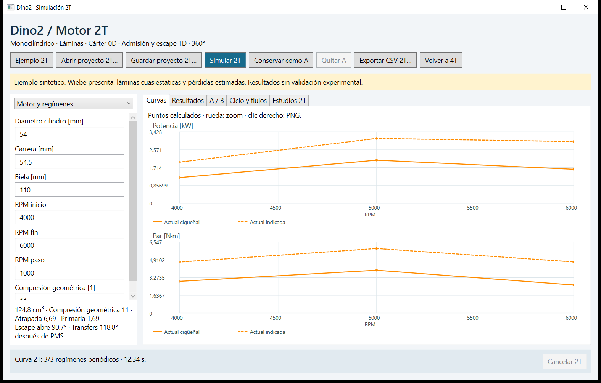

# Manual de Dino2 Desktop

## Proyectos de etapa 12

Abrí `4t-physical-stage12.json` para el escape corto de 0,25 m o `2t-physical-stage12.json` para el monocilíndrico de 125 cm³. Los archivos `multi-4t-physical-stage12.json` y `multi-2t-physical-stage12.json` se abren desde su ventana multicilíndrica. Son ejemplos sintéticos con extremos de presión y acoplamiento `ports-v1`.

En **Conductos** o **Numérica**, 1 selecciona la boca de presión. 0 conserva el modelo adaptado para reproducir cálculos históricos. Si faltaba esa opción en un archivo antiguo, aparece como 2 con el aviso **LEGACY / NO PREDICTIVO**. Para actualizar un proyecto, conservá una copia, seleccioná presión y recalculá A y B. Los ejemplos 1D previos con contorno 0 o ausente son casos de regresión. Consultá el aviso antes de interpretar su curva.

Las curvas iniciales se calculan en la malla elegida. Una RPM periódica todavía puede ser sensible al paso espacial. En el ejemplo 2T el cambio de ×1 a ×8 llega a casi 5 % en algunos regímenes. Para investigar diferencias pequeñas usá el contraste de malla A/B con los mismos modelos y revisiones. El [informe de etapa 12](etapa12.md) muestra las series y los límites.

## Conductos y resultados de la etapa 11

Abrí `examples/4t-recovery-wall.json` desde la pantalla 4T o `examples/2t-recovery-pressure.json` desde la pantalla 2T. Calculá la curva y consultá el diagnóstico del régimen junto a los gráficos. Los ejemplos contienen geometrías sintéticas.

- **Extremo de presión.** Representa un depósito exterior ideal con reflexión. Para 4T monocilíndrico se puede elegir el contorno por ramal. **Histórico adaptado** recupera la formulación de proyectos previos y es útil como referencia para medir cuánto influye el contorno. Sus curvas de longitud requieren esa salvedad.
- **Pared de conducto.** Indicá rugosidad en µm y temperatura de pared en K si disponés de valores aplicables. Rugosidad −1 desactiva las fuentes. Rugosidad 0 significa pared lisa. Temperatura 0 conserva una pared adiabática con fricción cuando la rugosidad está activada.
- **Duración de combustión.** En el modo Wiebe, el valor explícito en grados de cigüeñal tiene prioridad sobre el tiempo en segundos. Vacío selecciona segundos. La ley condicionada calcula su propia duración.
- **Regímenes incompletos.** Un régimen inadmisible o fallido aparece con su diagnóstico y sin punto calculado. Los puntos válidos se conservan. La curva 2T absoluta requiere un contraste separado de malla para estudiar cambios pequeños. El contraste A/B exige condiciones numéricas y de contorno comparables.
- **Procedencia.** Las nuevas curvas registran compilación y revisión numérica. Para recuperar resultados históricos de procedencia incompleta, conservá el proyecto, verificá sus hipótesis y repetí el cálculo. Los proyectos 2T nuevos llevan un resumen SHA-256 del contenido y se comprueba la coherencia física de las curvas guardadas.

Los resultados se interpretan dentro del [dominio verificado de la etapa 11](etapa11.md).

## Inicio y proyectos

Extraé el contenido completo del portable y ejecutá **Dino2.Desktop.exe**. Dino2 abre una sola ventana con el panel lateral **Motores**: **Motor 4T**, **Motor 2T**, **Multicilíndrico 4T**, **Multicilíndrico 2T** y **Otto ideal**. Al iniciar muestra **Motor 4T** con un ejemplo sintético. Cada simulador se crea al elegirlo y conserva proyecto, curvas y estudio de la sesión al cambiar de motor. Un punto ámbar junto al nombre indica cambios sin guardar; al cerrar Dino2 se confirma cada motor modificado y se espera la cancelación de los cálculos en curso.

La barra superior agrupa los comandos: archivo (**Ejemplo**, **Abrir…**, **Guardar…**, **Exportar…**), simulación (modelo físico, ley de combustión y **Simular**), comparación (**Conservar como A**, **Quitar A**) y datos de entrada (importación de alzadas o contornos). Al pasar el puntero sobre un botón se muestra su descripción completa. Atajos: **F5** simula, **Ctrl+O** abre, **Ctrl+S** guarda, **Ctrl+E** exporta y **Esc** cancela el cálculo. **Cancelar** y el indicador de avance están en la barra de estado. En ventanas de menos de 1200 px de ancho el panel lateral muestra solo íconos; el nombre de cada motor aparece al pasar el puntero. Para continuar en otro momento, guardá los archivos antes de cerrar Dino2. La aplicación inicia con el ejemplo y cada proyecto guardado se recupera con **Abrir**.

1. **4T.** Elegí **Ejemplo** para iniciar un proyecto o **Abrir…** para usar uno de **examples**. Elegí el modelo físico (v1 pseudoaire, v2 iso-octano con productos congelados, v3 equilibrio UV o v4 con conductos 1D de primer orden o MUSCL) y la ley de combustión (Wiebe prescrita o escalada; v1 usa siempre la prescrita). El formulario habilita los parámetros pertinentes. Las cifras de **Evidencia** pueden registrarse junto a procedencia y dominio de identificación. Esa declaración depende del respaldo aportado por el usuario.
2. **2T.** Elegí **Motor 2T** en el panel lateral y luego **Ejemplo** o **Abrir…**. El selector izquierdo organiza motor y RPM, combustión y pérdidas, cárter y admisión, lumbreras y transfers, escape de expansión y resolución numérica. El resumen muestra cilindrada y relaciones de compresión geométrica, atrapada y primaria.
3. Los campos indican unidades. Se acepta coma o punto decimal y las RPM se ingresan como enteros. Las presiones se ingresan en valores absolutos. En los archivos de proyecto, la geometría y las ecuaciones usan SI. Mientras escribís, un campo que no puede leerse como número (o una RPM no entera) se marca en rojo y su ayuda emergente explica el problema; los campos deshabilitados no se marcan. Los parámetros fuera de rango y las combinaciones incompatibles se informan en el estado al simular.

## Calcular e interpretar

Configurá inicio, fin y paso de RPM y pulsá **Simular** o **Simular 2T**. El estado indica avance. **Cancelar** detiene el cálculo. En 4T, la curva actual se publica cuando el cálculo termina. En 2T, la tabla conserva los puntos evaluados, con el estado y diagnóstico de cada régimen. Las filas no periódicas o fuera de dominio tienen potencia y par vacíos. La curva de un barrido parcial usa marcadores.

- **Curvas.** La leyenda identifica A, B o Actual. El trazo discontinuo identifica la indicada y el continuo identifica la estimación al cigüeñal en curvas completas. Las líneas guían la lectura entre muestras. Los ejes usan marcas redondas (pasos 1, 2 o 5 por potencia de diez) y el eje vertical termina en un valor redondo. Al pasar el cursor, una línea vertical y un recuadro muestran la muestra calculada más próxima de cada curva. Sobre un gráfico, usá la rueda para ampliar, arrastrá para mover la vista ampliada y pulsá **Inicio** o hacé doble clic para ajustar. Con foco en el gráfico funcionan **+**, **−** y las flechas. El menú contextual permite guardar la vista en PNG.
- **Resultados.** La tabla admite ordenación por encabezado. La potencia indicada neta parte del trabajo de los gases. La potencia y el par estimados al cigüeñal incorporan pérdidas modeladas. En 4T, la eficiencia volumétrica mide el llenado en la convención del modelo. En 2T se distinguen entrega, atrapamiento, barrido y carga.
- **Ciclo en 4T.** Elegí la RPM para ver presión, p–V, temperatura y balances. Los modelos termoquímicos muestran composición de fin de ciclo. **Conductos** añade presión y caudal en admisión y escape cuando el motor usa 1D. El caudal positivo se dirige hacia el cilindro.
- **Ciclo y flujos en 2T.** La vista muestra presión de cilindro y cárter, otra gráfica para las ondas junto a láminas y lumbrera de escape, temperatura, caudal y composición residual al cierre. En el gráfico de caudales, transfers positivos se dirigen al cilindro y escape positivo sale del cilindro. Podés desplazarte para recorrer las cuatro gráficas.
- **Diagnósticos.** Interpretá ciclos, residuo periódico, balances, procedencia y estado de convergencia junto con la curva. Una periodicidad aceptada corresponde a un régimen estabilizado con los parámetros elegidos. Los balances y la resolución de malla cuantifican efectos distintos.

[Captura de la presión de admisión y escape en 2T](figures/desktop-2t-ciclo-etapa8.png).

## Comparaciones y estudios

**Conservar como A** fija una referencia. Editá un parámetro y simulá B. **Quitar A** retira la referencia del proyecto. **A / B** muestra diferencias B−A para RPM comunes calculadas. Las diferencias positivas corresponden al cálculo de esa configuración. Revisá la identidad del modelo y la resolución antes de interpretar el resultado.

Con geometrías y ajustes compatibles, **Comprobar malla A/B** en 4T 1D y **Verificar malla A/B** en 2T ejecutan refinamientos en la RPM elegida. La banda observada orienta la interpretación. Una diferencia que queda dentro de ella puede ser indistinguible. El resultado se refiere a resolución numérica.

- **4T.** Abrí **Estudios**, elegí **Tomar motor actual** o **Tomar original A**, y configurá uno a tres ejes, grilla y objetivo. Revisá el costo y ejecutá. Examiná resultados, curvas, puntos y sensibilidad. El contraste permite elegir referencia, y aplicar B conserva el original del proyecto.
- **2T.** En **Estudios 2T**, abrí **Plan**, elegí motor base, uno o dos parámetros, rangos, objetivo y núcleos. Las RPM provienen de la grilla del motor base. Una banda de objetivo puede seleccionar un subconjunto. Tras ejecutar, **Candidatos** permite contrastar contra la base y **Aplicar como B**. También hay vistas de curva y diagnósticos.
- En ambos casos, la preselección ordena las muestras convergidas por el objetivo. Los estudios pueden guardar sus resultados parcial o completamente, incluidos los contrastes disponibles. Guardalos desde la propia pestaña antes de reemplazarlos o salir. El exportador CSV sirve para análisis externo.

## Archivos y exportación

| Módulo | Proyecto JSON | CSV |
|---|---|---|
| Otto | Configuración del ciclo | Curvas e información del cálculo |
| 4T | Configuraciones A y actual. Al abrir, **Simular** reconstruye las curvas. | Curva, traza de la RPM elegida, original y diferencias si existe A. El contraste disponible genera un JSON adicional. |
| 2T | Configuraciones, curvas disponibles y último contraste A/B | Curva 2T y comparación si existe A. **Exportar ciclo CSV…** guarda la traza de la RPM elegida. El contraste disponible genera un CSV adicional. |
| Estudios | Definición, evaluaciones, estado parcial y contrastes | Resultados y evidencia de clasificación, con unidad e identificación según el formato de la familia |

Cada módulo abre sus propios archivos. Si la apertura falla por versión, contenido, permisos o ruta, el estado informa el error y el proyecto anterior permanece disponible. Guardá con un nombre claro antes de cambiar parámetros. Un PNG conserva la vista elegida, mientras que el CSV conserva los valores numéricos.

## Casos para reproducir

| Caso del directorio **examples** | Recorrido |
|---|---|
| **otto-400cc.json** | En Otto, abrí el ejemplo y pulsá **Calcular**. La potencia indicada ideal sigue la RPM con par constante. |
| **4t-equilibrium.json** | Abrí en 4T y simulá. Inspeccioná presión y temperatura en **Ciclo**. |
| **4t-ducts-muscl-ab.json** | Abrí en 4T, simulá A y B y compará geometrías en **A / B**. Elegí la RPM y contrastá si los ajustes son compatibles. |
| **study-spark-v3.dino-study.json** | Abrí mediante **Abrir estudio…** dentro de 4T. Consultá los resultados guardados. |
| **2t-125cc-escape-ab.json** | Abrí en 2T, simulá y contrastá a 5000 RPM. El informe incluye la resolución de ese caso. |
| **2t-125cc-partial-domain.json** | Simulá en 2T y comprobá la fila de 5000 RPM periódica y la de 10 000 RPM fuera de dominio. |
| **2t-125cc-wide-rpm.json** | Ejecutá la grilla de 500 a 10 000 RPM, de 500 en 500. El cálculo es más largo que el ejemplo de tres puntos. |

Para un cálculo fallido, revisá el mensaje, las unidades, la distribución, el modelo y los parámetros numéricos. En 2T, usá el componente dominante y los ciclos completados para diagnosticar asentamiento. La ficha científica delimita qué parámetros son prescritos o estimados y dónde falta evidencia experimental. [Referencia científica](referencia-cientifica.md).

## Motor multicilíndrico 4T

En el panel lateral elegí **Multicilíndrico 4T**. El ejemplo cargado tiene dos cilindros. Usá **Abrir** para seleccionar los ejemplos **multi-4t-inline2.json**, **multi-4t-inline3.json** o **multi-4t-inline4.json**. También podés importar un proyecto 4T termoquímico que ya tenga ramales 1D. La importación toma su configuración actual como plantilla común para los cilindros y aplica los colectores del ejemplo.

- **Motor** elige cantidad, fases de PMS, esquema 1D y ley de combustión. Las fases se expresan en grados respecto al PMS de combustión del cilindro 1. El esquema muestra conexiones y orden.
- **Ramales** ajusta el par de tubos que se instalan en cada cilindro. **Colectores** ajusta cada tronco y volumen de unión. **RPM / cálculo** define el barrido y los controles numéricos.
- **Simular** ejecuta el modelo en segundo plano. **RPM** muestra el estado y los balances. Una RPM no periódica queda vacía en las gráficas de rendimiento. **Cilindros y ciclo** permite elegir A o B y un régimen periódico, consultar contribuciones y exportar CSV por cilindro o ciclo.
- **Conservar como A** guarda una copia de la configuración y la curva. Editá B y volvé a simular. En **A/B**, seleccioná una RPM y ejecutá el contraste a tres resoluciones antes de interpretar una diferencia pequeña. El contraste puede tardar sensiblemente más que la curva base.
- **Estudios** toma el motor actual o A como base fija. Ajustá el barrido en el editor del motor antes de tomarlo. Elegí hasta tres ejes, objetivo, banda opcional y trabajadores. La clasificación ordena casos muestreados. **Contrastar objetivo** repite el candidato y la base en tres resoluciones. **Aplicar como B** conserva A y permite volver a simular con trazas completas.
- **Guardar…** conserva configuraciones, curvas, contrastes y el estudio ejecutado. **Exportar…** guarda la curva actual o A si es la única calculada. Las pestañas ofrecen los CSV de ciclo, resumen por cilindro, A/B y estudio. El menú contextual de los gráficos permite ajustar vista, desplazarse tras ampliar y exportar PNG.

Las presiones son absolutas. El par instantáneo representa los gases. Las pérdidas del cigüeñal se estiman como trabajo medio por ciclo. Los casos disponibles sirven para reproducir la verificación numérica. [Modelo y límites](modelo-multicilindrico-4t.md).

## Motor multicilíndrico 2T

En el panel lateral elegí **Multicilíndrico 2T**. **Abrir** permite usar **multi-2t-inline2.json**, **multi-2t-inline3.json** y **multi-2t-inline4.json**. **Importar 2T** toma la geometría actual de un proyecto monocilíndrico y abre la configuración con ramales y escapes independientes.

- **Motor y fases** selecciona de dos a cuatro cilindros en línea, desfases dentro de 360° y redes compartidas. El esquema muestra cárteres y transfers separados por cilindro.
- **Colector de admisión** y **Colector de escape** editan el tronco, los volúmenes de unión y los primarios. **Escape de expansión** edita difusor, tramo central, cono y salida. Con escape compartido, esas dimensiones describen la expansión después de la unión.
- **Simular** calcula el barrido definido en **Motor y regímenes**. **RPM** informa periodicidad y balances. **Ciclo y barrido** muestra presión de cilindro, cárter, puertos, colectores y flujos. El origen es la apertura de escape del cilindro 1.
- **Conservar como A** fija el original. Editá B, volvé a simular y seleccioná una RPM común en **A/B** para contrastar numéricamente. El cálculo de tres mallas puede durar varios minutos.
- En **Estudios**, tomá el motor actual o A, elegí uno o dos parámetros y un objetivo. Consultá el costo y aplicá la fila elegida como B. Al simularla se obtienen las trazas angulares.
- **Guardar…** conserva configuraciones, curvas, contraste y estudio. Las pestañas exportan CSV de ciclo, contribuciones, A/B y estudios. Los gráficos conservan zoom, desplazamiento y PNG.

La potencia al cigüeñal se estima restando pérdidas. El par instantáneo corresponde a las presiones del cilindro y del cárter. [Modelo 2T multicilíndrico](modelo-multicilindrico-2t.md).
